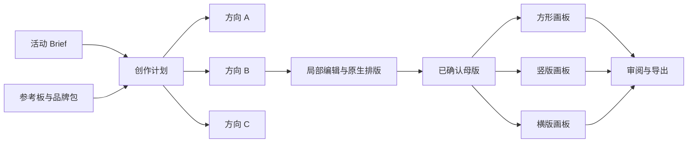
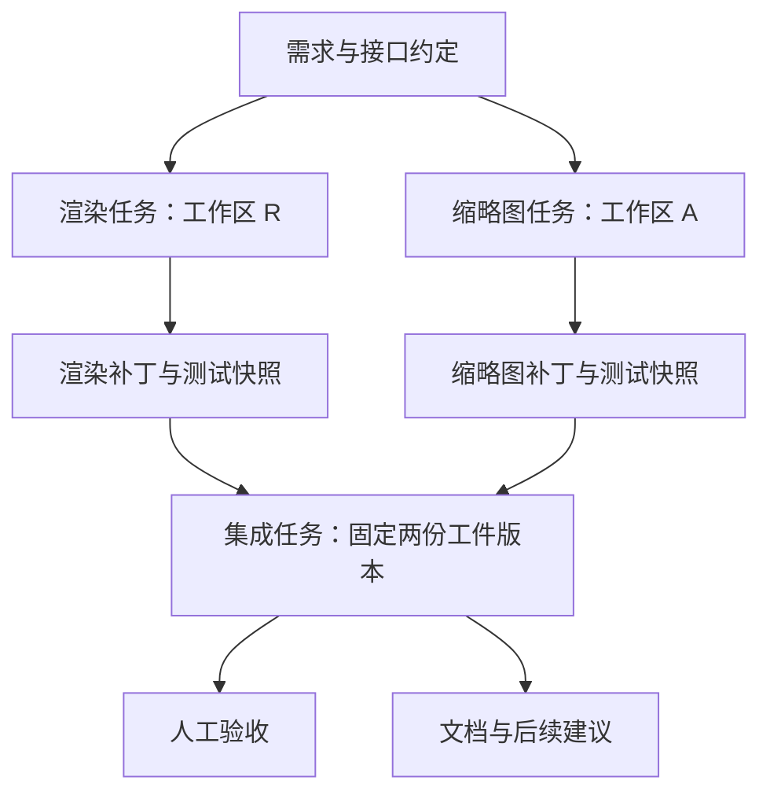
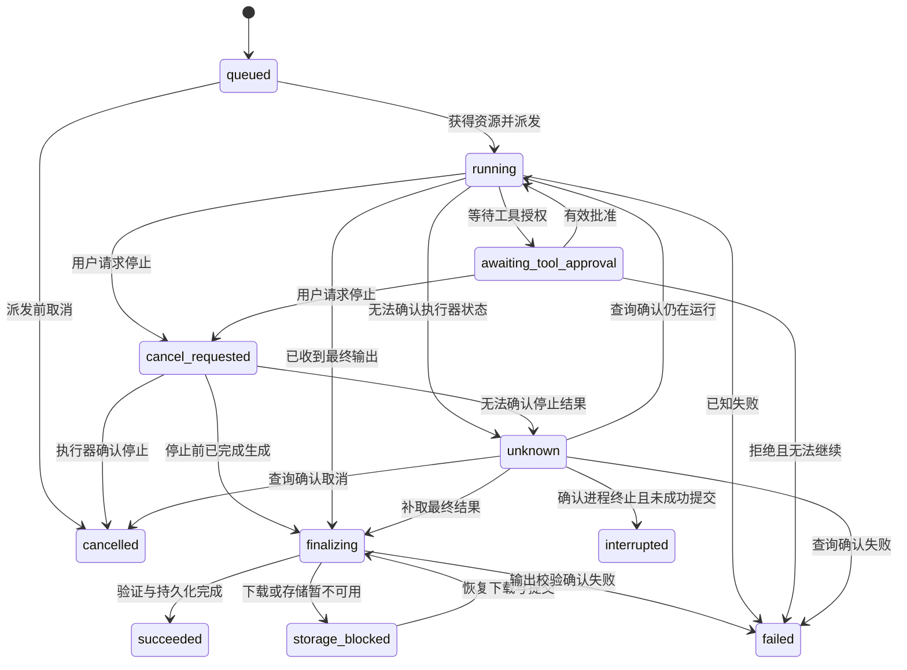
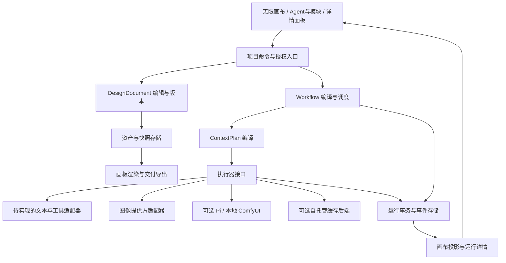

# Ravomi AI 运行与多 Agent 协作设计

版本：0.7（保留原设计编号）· 更新：2026-10-12 · 状态：完整运行领域设计草案；已协调节点对话检查点需求，新增检查点/分叉契约尚未实现；React/Tauri 与原生 Bevy 已接入代码 MVP 子集。

> 本文定义任务、Agent、运行、上下文、工件与交接的领域契约。产品范围、功能状态和发布顺序以 [PRD](PRD.md) 为准；界面以 [DESIGN](DESIGN.md) 为准；供 AI 设计和编写界面的执行规则见 [AI_UI_RULES](AI_UI_RULES.md)。保留既有 G01–G14、G21–G33、V01–V16 与验收编号，不补造缺失编号。

Ravomi 是 Arcraven 的产品。当前仓库同时包含 Rust/Bevy 画布、`app/` React/Tauri 迁移原型和 Wry 内嵌 React 输入层。`src/collaboration.rs` 与其子模块实现代码 MVP；`src/canvas_ai.rs` 为原生画布入口，`app/src/Collaboration.tsx` 保留独立原型入口。旧上游 `app/src/core/`、`packages/`、AIEngine 等模块没有因此成为本仓库已实现能力。来源见 [MIGRATION](MIGRATION.md)，当前入口见 [README](README.md#文档与项目结构) 和 [app/README](app/README.md)。

原生画布的绑定保存在 `.mio` / 兼容 `.prg` 的附件 `ravomi-code-agents.json`，仅关联输入节点、任务和流程编号；固定源码、完整日志仍位于用户数据目录 `ravomi/code-collaboration-canvas/workflows.json`。与 Tauri 数据目录分开，当前不做两个入口之间的会话迁移。打开画布不自动重发，但 Bevy 全局运行区仍可手动操作本机全部已载入流程；项目副本与运行控制的实例隔离尚未实现。Space 只授权本次固定输入的新流程。Skill 总结使用 `$skill` Run、固定来源证据和同一 Pi 执行器，保存经过人工编辑的内容及证据副本，不自动加载或执行 Skill。

**当前子集与设计差异**：Pi Agent Core / Pi AI 1.0.4 编译为应用私有引擎；Rust 承担 DAG 调度、单任务单 Agent、固定输入快照、显式父子检查任务、取消/重试与按 Run 审阅。画布文字任务不要求外部工程。就绪任务不设固定并发、任务或调用次数上限，单次执行仍有超时和输出大小校验。持久化暂采用单后端互斥锁保护、一次替换整个快照的版本化 JSON，保留 64 MiB 校验边界；不实现本文完整 SQLite 事件模型、独立 Artifact ID 或审阅事件历史。每个 Run ID 标识一次工件版本。任务开始后计划不可修改，修订需新流程；外部会话续聊、工具循环和 Skill 自动复用待实现。画布节点目前是计划内 Agent 的空间投影。代码测试使用隔离目录但具有宿主权限；只导出人工通过的新目录，不写回原项目。完整契约仍作为后续目标，不能以本子集宣称全部完成。

本文以可见、可连接、可干预的多 Agent 协作为主线。研究、写作、编码和视觉创作共用同一套运行契约；视觉图层、品牌包和多尺寸交付属于领域扩展，不再决定整体首发范围。Jaaz、Lovart 等旧参考保留在第 15 节，不覆盖用户已确定的 Arc 式素净 UI 与团子猫品牌。

“应、必须”表示拟交付契约；“已有”仅指经过仓库核对的能力；性能数字为待验证目标，不代表当前测量结果。本文交付设计，不表示已安装依赖、接入外部服务或实现功能。

## 1. 产品定位与关键决定

### AI 正文表达与画布呈现（当前代码 MVP）

新建画布文字任务（无外部工程且没有旧 Agent 投影）采用回答思维导图：`summary` 使用两空格缩进的 Markdown 无序列表，每行一个知识点；投影为连接到原始输入的多级文本节点。规划不投影为节点。正文仍保存在原有字符串字段中，Run 来源与节点 ID 保存在画布绑定附件的 `answer_maps`，不新增容器 schema。为保证画布可处理，单次回答投影最多 256 个节点、8 层缩进；这不是 Agent 并发上限，超限明确报错并保留运行正文。旧 Agent 分组和代码工程任务继续使用下述分组呈现。

- 默认使用中文。借鉴 ASD-STE100 的清晰表达原则：先回答问题，使用短句，一句一个意思，一条操作一个动作；术语一致，缩写首次解释，明确区分事实、推测和未验证结果。此约束通过运行提示词应用于规划、任务及 Skill 总结；不是受控英语合规认证，也没有完整词典验证器。
- Agent 节点的内容是实际回答。任务输出使用已解析的 `proposal.summary` 全文；规划节点显示步骤及完成条件。原始 JSON、历史运行编号及完整日志保留在运行详情和项目记录中，不用它们代替正文。
- 新结果完成时自动展开一次。正文固定宽度换行，高度随内容增长；标题和状态放在分组标题中。手动折叠后，刷新和重开不反复展开同一次结果。兼容旧绑定，首次同步已完成结果时展示正文。
- 新表达约束只影响后续运行，不改写已保存的回答，也不自动重新请求模型。
- 信息组织参考 [i-have-adhd](https://github.com/ayghri/i-have-adhd/blob/main/skills/i-have-adhd/SKILL.md)：首行给答案或动作，多步操作编号，每组列表尽量不超过五项，未完成时给一个具体下一步。完整性优先；解释型问题保留充分说明，不编造耗时，不把 ADHD 诊断作为用户属性。实现规则集中在 `src/collaboration/output_style.txt`，通过 `new_run` 应用于所有新运行；重试不重复叠加相同规则。本轮未安装该插件或全局 Skill。

### 1.1 产品定义

Ravomi 是桌面优先的多 Agent 协作工作空间。用户在无限画布上召唤并管理多个 Agent，将代码、素材、任务与子代理组织为可连接的模块。AI 拆解 TODO、编排工作流程并按需交接任务与上下文；人可以随时查看进度、介入调整，同时并行推进其他任务分支。

一个项目可以同时包含调研、设计和工程工作。核心是让人在掌握全局的同时，灵活推进多个工作方向。运行与审阅分离，上下文按需选择，产物固定版本；某一分支等待或失败时，不冻结其他独立分支的工作。连接外部会话、模型 API 或本地工具是执行器适配方式，不改变产品核心模型。

### 1.2 本版明确的产品决定

| 决定                   | 具体含义                                                                         |
| ---------------------- | -------------------------------------------------------------------------------- |
| 多种工作共用一个项目 | 画布组织 Agent、任务、代码与素材；领域视图按需展开。切换不复制资产、不触发执行 |
| 画布是操作入口         | 持久化项目数据和运行记录是事实依据，节点是其可视化投影；坐标变化不改变运行语义   |
| 任务、运行、结果分离   | 任务可修订；每次执行创建 Run；提交后的结果快照只读。编辑与重试不覆盖历史         |
| 可编辑设计有明确边界   | 原生文字、Logo、图片和基础形状可独立编辑；生成位图默认是一层，不宣称恢复真实图层 |
| 显式上下文             | 用户能看到发送了哪些文字、图片、品牌版本和结果。靠近、框在一起不等于授权发送     |
| 缓存是加速能力         | 连线控制依赖与输入；缓存命中由后端报告。缓存失效不应导致资料丢失                 |
| 自动化有范围           | 自动生成建议、自动创建草稿、自动执行分别配置，受范围、权限和预算约束             |
| 可靠性随功能交付       | 快照、停止、恢复、工作区隔离与导出校验进入相应功能的首个可用版本                 |

### 1.3 对 v0.3 的主要修正

- 移除“零首字延迟、零重复计费、固定节省 70%～90%、彻底消灭循环”等未经验证的保证，改为可观测指标和可测边界。
- “完成后冻结整个节点”改为“冻结运行结果，保留可编辑任务与设计草稿”。
- “断线即切断当前上下文”改为“断线影响未来执行；当前 Run 保持已固定的输入”。
- 多源汇合先组成确定的输入包，不能将多份分支 KV 当作可任意拼接的显存块。
- 基础 Group 复用现有 Section；代码文件隔离提前到首次并行写入阶段。
- 补齐原先仅以“保留 v0.2”引用的 G01–G14，使本文可独立用于开发和验收。
- 渲染与应用入口可以逐步演进；业务契约不绑定某个渲染器，不以界面迁移冒充 AI 能力完成。

## 2. 用户、场景与交付范围

### 2.1 核心用户

| 用户             | 高频任务                                   | 当前痛点                                   | 希望获得的结果                   |
| ---------------- | ------------------------------------------ | ------------------------------------------ | -------------------------------- |
| 品牌与视觉设计师 | 从 Brief、参考图生成多个方向，反复局部修改 | 对话、素材与版本分散；改一处可能破坏全图   | 保留思考过程、可编辑排版与定稿   |
| 创作者、市场运营 | 活动海报、封面、方图、竖图                 | 每个尺寸重复生成；文案、Logo、颜色容易偏离 | 从母版生成一套一致的物料         |
| 小团队负责人     | 比较、提意见、验收                         | 不清楚哪版已确认、还缺什么                 | 意见绑定版本，明确交付清单与待办 |
| 开发者、研究者   | 并行调研、编码、测试、集成                 | Agent 上下文与副作用难追踪                 | 可检查输入与依赖的有界任务流程   |

### 2.2 核心协作与领域闭环

核心协作闭环：**描述目标 → 拆解可编辑 TODO → 分配 Agent 和显式上下文 → 并行推进独立任务 → 交接固定结果 → 人工介入或审阅 → 汇合交付。** 单次可靠执行是其基础；多 Agent 协作首发不需要先完成视觉图层编辑器。

视觉创作是该模型的一种扩展闭环：

**创建 Brief → 收集参考与品牌资产 → 生成方向 → 选定并编辑画板 → 派生尺寸与版本 → 审阅 → 导出交付。**

视觉阶段拟支持海报、品牌视觉探索、社媒套图；品牌功能包括品牌资产包与视觉规范约束，不等于自动完成全套专业 VI。Logo 可用于探索与组合，精确矢量标志和专业印前流程需独立验证。

首发项目由一名本地用户控制。支持导入反馈、分享导出包，暂不要求多人实时编辑、云端团队资产管理或跨设备运行同步。

### 2.3 范围分层

| 层级    | 包含                                                                                                               | 暂不包含                                                            |
| ------- | ------------------------------------------------------------------------------------------------------------------ | ------------------------------------------------------------------- |
| 协作 P0 | 单次可靠执行、显式上下文、持久化成果、基础多 Agent 分工与交接、有界 DAG、TODO、停止与恢复；并行写入前提供隔离 | 无预算自主扩张、分布式调度、关闭应用后持续运行的守护进程 |
| 视觉扩展 P0 | Brief、参考板、品牌包、图像生成、原生排版、画板、版本比较、选区编辑、基础套图、PNG/JPEG 与项目源文件导出 | 视频时间线、3D、广告投放、完整 Photoshop/Illustrator 替代 |
| 进阶 P1 | 高级团队策略、批量模板、条件 SVG/PDF 导出、品牌检查、供应商缓存统计 | 自动合并任意代码、任意素材无损分层 |
| 实验 P2 | 自托管 KV、多块缓存融合、复杂图层重建 | 未验证的跨模型缓存共享、5000 节点稳定 60 FPS 承诺 |

P0/P1/P2 是各自能力阶段的优先级。V 系列 P0 表示进入视觉扩展时必须完成，不要求与协作首发同一迭代交付；阶段依赖见第 17 节，总体范围以 PRD 为准。

### 2.4 成功指标

| 指标           | 定义与验证方式                                                     |
| -------------- | ------------------------------------------------------------------ |
| 协作闭环可解释 | 用户可从全图定位运行、依赖、交接和待介入项，并查看对应输入和成果 |
| 并行工作可持续 | A/B 独立运行时仍可编辑 C；A 等待审阅或失败不阻止 B/C 的独立操作 |
| 人工介入有范围 | 暂停派发、停止、修订输入、重新分配与审阅都显示影响对象，当前 Run 输入不漂移 |
| 创作闭环可完成 | 从 Brief 与参考图出发，完成 3 个方向、1 张定稿、3 种尺寸的物料包   |
| 精确文案可控   | 原生文字层修改标题、价格、日期，不调用图像模型；导出与批准文案一致 |
| 历史可追溯     | 生成资产可定位输入、Run、模型记录与父版本；已提交内容哈希不变      |
| 自动化可收束   | 达到数量、调用、时间或人工审批边界后停止派发，原因可见             |
| 导出可信       | 尺寸、格式、选定版本与文件一致；部分失败不能显示全部成功           |
| 缓存收益可解释 | 实测冷/热耗时、命中、用量与费用；未知值不填 0                      |

## 3. 当前仓库基础与接入边界

以下为本地接入基础，不表示 AI 功能已实现。历史上游同名目录不能直接当作本地接口使用。

| 已有基础          | 位置                                                                                  | 可复用部分与缺口                                                |
| ----------------- | ------------------------------------------------------------------------------------- | --------------------------------------------------------------- |
| 文档与历史 | `src/document.rs`、`src/session.rs` | 复用文档命令与撤销，增加任务/工件格式需要迁移和往返验证 |
| React/Tauri 原型 | `app/src/App.tsx`、`app/src/Collaboration.tsx`、`app/src-tauri/src/lib.rs` | 对象列表、文字编辑与代码协作；Agent 空间布局待接入 |
| 空间画布与分组 | `src/viewer.rs`、`src/sections.rs`、`src/edges.rs` | 复用投影、关系与选择；文档连线不是运行依赖，分组不是自动团队授权 |
| React 原位输入 | `src/react_editor.rs`、`src/edit_protocol.rs`、`app/src/canvas-editor.tsx` | 保留草稿、IME 与提交语义，不复用为第二个运行状态来源 |
| 素材与图谱导出 | `src/image_import.rs`、`src/export_image.rs`、`src/export_ui.rs` | 已有附件与 PNG 基础；完整视觉图层、作业及交付清单待实现 |
| 本地恢复 | `src/recovery.rs`、`src/recovery_ui.rs` | 文档恢复副本不能代替 Run 事务日志和副作用恢复 |
| 执行器、上下文与存储 | `src/collaboration/`、`app/agent-engine/` | 内置 Pi、固定源码、版本化 JSON；完整事务事件模型和外部会话待实现 |
| 历史 AIEngine、KV 研究 | 旧设计参考，非本地已接入模块 | Pi 已按新入口接入，不包含旧 AIEngine、MCP 工具目录或缓存服务 |

## 4. 两条贯穿用户旅程

### 4.1 活动品牌与社媒物料

示例：为咖啡品牌制作秋季活动海报与社媒套图。

1. 创建项目，填写目标受众、主标题、日期、必备文案、用途、尺寸与禁止元素。
2. 导入 Logo、产品照片和参考图，分别标注“配色”“构图”“材质”“主体”，确认哪些可以发给模型。
3. 品牌包记录 Logo 原件、字体、色值和语气；精确 Logo 与文案采用原生层。
4. 选择“生成 3 个方向”，检查参考范围、作业数量、模型能力与预算后启动。
5. 结果进入独立预留位置；一个失败时保留其他成功项。用户并排比较并选择 B。
6. 双击 B 编辑画板：直接改标题、移动 Logo；圈选背景输入“更温暖，保留杯子”，生成 B2 候选。
7. 比较并采纳 B2，将主体、Logo、主标题设为约束，派生方形、竖版、横版画板。
8. 检查文案、溢出、品牌规则与反馈，确认版本，导出图片、源文件和清单。



生成任务对应 Run，图像与画板对应资产版本。参考板是资料容器，不自动变成执行队列。

### 4.2 多 Agent 工程协作

“实现画布连线与缩略图”拆成渲染和缩略图任务。两个 Agent 在各自工作区执行，共享显式选择的接口快照，产出补丁、测试记录与交接说明。集成任务等待两份结果提交后，固定版本、检查基线冲突、运行验证，再进入人工审阅。



编码任务遵守所属工程规则。本仓库按 [AGENTS](AGENTS.md) 和 [DEVELOPMENT](DEVELOPMENT.md) 运行相关 Cargo / 前端检查，没有从旧上游继承禁止构建的规则。验收通过不自动授予合并、推送或发布权限。

## 5. 功能需求目录

### 5.1 基础资料与问答（补齐 G01–G14）

| 编号 | 优先级 | 需求与交付边界                                 |
| ---- | ------ | ---------------------------------------------- |
| G01  | P0     | 主题和 Brief：目标、约束、验收条件与版本       |
| G02  | P0     | 新建问答或任务，选择已有对象作为输入           |
| G03  | P0     | 文本流式展示、执行状态与请求停止               |
| G04  | P0     | 从结果追问、分叉，原结果保留                   |
| G05  | P0     | 多来源引用，显示片段、固定版本与排序           |
| G06  | P0     | 多源汇合，固定输入包并提示冲突                 |
| G07  | P0     | 输出快照只读，编辑和执行创建新版本             |
| G08  | P0     | 历史查看、比较、恢复为新草稿                   |
| G09  | P0     | 资料与资产可定位来源和 Run                     |
| G10  | P0     | 标题、正文、标签、批准文案搜索；OCR 可选       |
| G11  | P0     | 平移缩放、框选、分组、折叠、搜索定位           |
| G12  | P0     | `.prg` 保存、另存、备份、迁移和必要素材携带    |
| G13  | P0     | 编辑撤销/重做，不删除审计或回滚外部副作用      |
| G14  | P0     | 失败、断网、超限、缺失输入的明确原因与恢复入口 |

### 5.2 任务与多 Agent（延续 G21–G29）

| 编号 | 优先级      | 需求与交付边界                                        |
| ---- | ----------- | ----------------------------------------------------- |
| G21  | P0          | Task / Run / Snapshot 分离，固定输入、事务提交        |
| G22  | P0          | 结构化 TODO 建议，可自动创建草稿，独立控制自动执行    |
| G23  | P0/P1       | P0 上下文选择；P1 供应商缓存策略和观测；物理 KV 放 P2 |
| G24  | P0          | 有界 DAG、并发配额、Fork/Join，首版仅 `all_success`   |
| G25  | P0          | 自由改图，运行固定修订；显式停止并重新规划            |
| G26  | P0/P1       | P0 显式 Agent/子代理职责与执行器；P1 Section 团队策略继承 |
| G27  | P0          | 跨 Agent 交接固定工件和结构化消息                     |
| G28  | P1          | 请求级缓存与耗时可视化，缺少数据显示未知              |
| G29  | 涉及并行写入时的 P0 | 首次并行文件写入即提供工作区隔离与合并冲突保护 |
| G30  | P0          | 执行、工具调用、结果验收三类授权，绑定实际内容        |
| G31  | P0          | 调用、时间、并发、衍生数量与费用预算                  |
| G32  | P0          | 派发、终态与副作用恢复，不盲目重试状态不明操作        |
| G33  | P0          | 事件去重，重复完成不产生重复结果                      |

### 5.3 视觉创作领域扩展

以下 P0 仅约束视觉扩展闭环，不是通用协作首发的附加门槛。

| 编号 | 优先级 | 需求与交付边界                                               |
| ---- | ------ | ------------------------------------------------------------ |
| V01  | P0     | 创作/流程视图，共用对象与历史，默认隐藏非必要技术信息        |
| V02  | P0     | 参考板：导入、粘贴、标签、来源与引用用途                     |
| V03  | P0     | Brief、固定文案、画板规格与完成清单                          |
| V04  | P0     | 品牌包：Logo、字体、色值、语气、约束与版本                   |
| V05  | P0     | 文生图、参考图生成、多方向候选、部分失败独立重试             |
| V06  | P0     | 选中/圈选发起修改，预览实际目标与参考范围                    |
| V07  | P0     | 原生文字、图片、Logo、基础形状；层级、锁定、显隐、对齐、裁剪 |
| V08  | P0     | 固定尺寸画板，独立坐标与可验证的导出边界                     |
| V09  | P0     | 非破坏版本、对比、采纳、回退与定稿标记                       |
| V10  | P0     | 母版派生三个自定义尺寸，保留精确文案与 Logo，逐版审阅        |
| V11  | P0     | PNG/JPEG 批量导出、源文件与清单，逐项报告结果                |
| V12  | P0     | 意见绑定版本和区域，处理意见不改写旧版本                     |
| V13  | P1     | 模板套图、文案变量、布局约束与品牌检查                       |
| V14  | P1     | 条件 SVG/PDF 导出、AI 抠图、扩图、超分，按执行器能力启用     |
| V15  | P2     | 自动拆层与复杂矢量重建，明确质量与可编辑程度                 |
| V16  | P0     | 选择素材、草图与视觉标注后生成，预览实际合成输入，保留来源   |

## 6. 信息架构与界面设计

本节规定运行信息如何呈现，视觉 token、尺寸、输入与可访问性以 [DESIGN](DESIGN.md) 为准，供 AI 实施的规则见 [AI_UI_RULES](AI_UI_RULES.md)。界面保持素净清晰；品牌小猫采用一体团子、双耳双眼、石墨黑和局部雾蓝紫细颗粒柔光，无嘴、鼻、须、尾巴和四肢。材质不扩散到文字、卡片与连线上。

### 6.1 工作区布局

```text
┌ 导航侧栏 ┬ 项目名 · 保存状态 · 运行与待介入摘要 ───────────────┐
│ 工作空间 │ 无限画布                              │ 按需详情   │
│ 画布     │                                       │ 任务目标   │
│ Agents   │           ┌ 研究 Agent → 研究成果 ┐   │ 输入上下文 │
│ 文件     │ 目标 → 计划                         汇合 │ 文件/版本 │
│          │           └ 开发 Agent → 代码模块 ┘   │ 运行活动   │
│ 项目列表 │              素材 / TODO / 子代理     │ 审阅/介入  │
│          │                                       │            │
│ Arcraven │ 目标输入 / 添加模块          缩放与定位 │            │
└──────────┴───────────────────────────────────────┴────────────┘
```

- 默认画布显示任务、Agent、模块和关键连接，详情按选择展开；运行中仍可编辑未受影响的分支。
- 视觉领域视图可突出缩略图与画板；选中素材提供适用的参考、编辑、变体和来源入口，不要求所有工作都先进入创作视图。
- 切换仅改变显示与局部布局；对象 ID、版本和选择保留，隐藏对象仍能通过大纲定位。
- 右侧面板随选择切换：项目 Brief、资产属性、执行详情或输入规则。
- 结果进入预留槽位或任务旁的结果区，不自动打乱已有布局。大量结果先折叠为集合。

### 6.2 选择与自然语言操作

“把背景改成暖色”必须有选定目标；面板列出目标缩略图。无目标时先选择对象，不由 Agent 猜测并覆盖项目。多选时明确区分“分别修改”“组合成新图”“仅作参考”。

拖入参考板只建立组织关系；点击“用于本次任务”或建立上下文引用才进入输入。执行预览显示实际发送的是原图、裁剪图、文字还是代理图；不能用缩略图预览掩盖实际上传范围。

### 6.3 画板编辑与图层

- 无限画布使用世界坐标，画板使用自身像素坐标；画布缩放不影响导出尺寸。
- 双击画板进入编辑，显示边界、图层列表、对齐参考线与属性；退出后显示预览。
- P0 原生层包括文字、图片、Logo、矩形/椭圆等形状；支持位置、大小、旋转、不透明度、层级、锁定、显隐、裁剪。
- 原生文字支持内容、字体、字号、字重、颜色、行距、字距、对齐与文本框宽度。缺失字体必须提示替代，不能静默改变排版。
- Logo 使用原始资产独立放置，默认锁定比例。标题、价格、日期、网址优先使用原生文字。
- 位图里的字仍是像素；“改文字”要区分原生文字修改与 AI 重绘。自动拆层不作为 P0 前提。
- 一次直接编辑是可撤销文档事务，不必创建 AI Run；冻结、生成、采纳分别记录版本。

### 6.4 局部编辑

1. 选择资产版本或图片层，用矩形/画笔创建蒙版。
2. 面板列出目标、指令、参考、保护区域和支持的编辑模式。
3. 固定原始资产、原图像素坐标下的蒙版、裁剪变换和参数，避免缩放导致错位。
4. “严格选区”按蒙版把生成结果合成回原图，选区外像素保持原样；羽化边界包含在可修改范围。后端不能提供可对齐输出时禁用此模式。
5. “允许整体协调”可修改其他区域，作为另一种显式操作。
6. 输出先成为候选，用户采纳前不替换草稿。失败、停止保留原图；用户在运行中修改草稿时，新结果也只进入候选区。

P0 至少验证一家图像生成与局部编辑执行器。其他后端缺少蒙版、指定尺寸等能力时，入口解释原因，不悄悄降级成整图重生成。

### 6.5 品牌与多尺寸

品牌包包含名称、版本、Logo、主辅色、字体来源、语气、固定文案和禁用变化。Logo、色值、最小字号等可机械检查；风格描述是生成偏好与审阅项。模型不保证绝对风格一致，精确元素由原生层控制。

Run 固定品牌版本；更新品牌包只提示“有新版本”，不静默替换成品。尺寸适配复制母版原生层并重新布局，按需裁剪、扩图或生成背景，不能把整图机械拉伸。额外模型调用显示新增作业数与预算。

母版改变后，仅更新用户选定的派生画板；先展示变更，保留各画板的手工覆盖与已审阅版本。每个尺寸可独立失败、重试和导出。

### 6.6 任务、边与分组

| 对象     | 默认呈现                          | 展开信息                     |
| -------- | --------------------------------- | ---------------------------- |
| 任务卡   | 标题、状态文字、缩略图、执行/停止 | 输入、权限、历史、用量、日志 |
| 关联边   | 细线，无执行含义                  | 关系说明                     |
| 依赖边   | 有向实线与等待标记                | 结果版本、阻塞原因           |
| 上下文边 | 有向虚线与引用标记                | 内容、版本、顺序、缓存偏好   |
| 团队分组 | 名称、角色、运行/失败/待审批数    | 执行器、权限、并发、工作区   |

同一对节点可同时有依赖和上下文引用；面板分别编辑，视觉可合并标记。允许缓存不等于已命中，不能据此点亮“命中”连线。Group 折叠保留阻塞数量，聚合锚点仍映射真实端点。

### 6.7 空态、错误与可访问性

目标首屏提供“描述目标”“添加 Agent”“导入素材”，按实际能力显示入口。未接入 Agent 的原型仍以新建草稿、打开文档等已实现操作为主；未配置模型时可继续普通画布编辑，不强制进入配置。视觉扩展可提供活动物料等模板，但不得占用通用协作的全部入口。

错误应能定位与恢复，例如“素材缺失：重新关联”“模型不支持局部编辑：切换执行器”“画板已变化：结果保存为候选”。详细错误进入运行详情，复用当前入口的可见错误通路，不假设旧上游 ErrorHandler 已存在，也不能仅写控制台。

状态同时使用文字与图标，提供减少动态效果、键盘选择、对象大纲、清晰焦点和可读标签。按当前组件与输入体系实现，不假设已安装 shadcn 或 UI skill，也不创建旧上游的国际化目录来满足历史文档。多语言接入时再明确文案来源与生成规则。

## 7. 领域模型与一致性规则

### 7.1 对象职责

| 概念              | 定义                                           | 变化方式                 |
| ----------------- | ---------------------------------------------- | ------------------------ |
| CanvasObject      | 位置、大小、折叠等呈现，引用业务对象           | 可编辑                   |
| AgentDefinition   | 稳定执行身份、职责、执行器配置及父代理关系 | 调整产生修订；不与单次 Run 混同 |
| TaskDefinition    | 目标、验收条件与执行配置                       | 修改产生修订号           |
| TaskRevision      | TaskDefinition 的某个固定修订，Run 引用其身份 | 不可变，修改产生新修订 |
| WorkflowExecution | 用户启动的一次有界流程，含范围、预算、结果映射 | 扩展范围形成显式计划修订 |
| ConversationCheckpoint | 有序对话内容、工件引用与历史来源；区别于整份项目存档 | 不可变；共享祖先内容，不代表全部内容进入模型输入 |
| Branch            | 指定检查点起点及当前头所表示的后续工作方向 | 比较预期头后推进；并发结果分别保留 |
| Run               | 一次尝试，固定输入、参数、权限与工作区         | 生命周期推进，输入不可变 |
| ResultSnapshot    | 已提交结果、验证记录与工件引用                 | 不可变                   |
| AssetVersion      | 图片、文档、补丁等内容与来源                   | 不可变；预览可重建       |
| Artifact          | 用户可引用的工件身份，具体内容由 AssetVersion 固定 | 新内容创建版本，不覆写旧版本 |
| Context / InputSnapshot | 显式选择并编译的本次任务输入，含来源、版本和范围 | 派发前固定，不共享隐式全部会话 |
| Handoff           | 来源/目标、目标说明、固定工件、关键决定与待办 | 消息内容固定，接收状态独立推进 |
| Review            | 针对指定结果版本的人工验收意见 | 新版本不自动继承旧版通过状态 |
| DesignDocument    | 画板与原生图层的编辑草稿                       | 可编辑                   |
| DesignRevision    | 某次画板检查点，固定所有图层和资产             | 不可变，可恢复为新草稿   |
| BrandKitRevision  | 某一版品牌资产与规则                           | 不可变                   |
| Feedback          | 绑定版本和局部区域的意见                       | 处理状态可变，目标保留   |
| DeliveryManifest  | 导出版本、规格、文件哈希和失败项               | 每次导出产生新记录       |

统一用语见 [CONTEXT](CONTEXT.md)。`ContentObject` 是 `AssetVersion`、消息等共同引用的不可变正文，不再引入与 `Artifact` / `AssetVersion` 同义的版本层。`Project Snapshot` 指整份项目存档；`ConversationCheckpoint` 指某个对话位置；`InputSnapshot` 指一次运行实际收到的内容，三者不能互换。

### 7.2 必须保持的不变量

1. 坐标变化不修改 Prompt、依赖、审批或输入；逻辑修改才递增语义修订号。
2. 派发前将输入解析为具体版本与内容，运行中不得继续读取“最新结果”。
3. 必需工件可读、结果校验通过并持久化后才能提交成功。
4. 失败与停止可保留部分输出，但不能默认满足成功依赖。
5. 删除画布对象不直接销毁被历史引用的资产，撤销不抹去执行事实。
6. 模型、图像任务、工具操作都有 Run/调用身份，重复事件不能重复产出。
7. 外部资料与模型建议是输入数据，不能提升权限或修改调度策略。
8. 可编辑源稿只包含真实保留的图层，位图不会因导出 SVG/PDF 而成为矢量。
9. 原始素材、生成资产和画板分别存储；原件不能只保存在临时 URL。
10. 执行授权、结果采纳、交付导出与外部发布是不同动作。
11. 普通节点可只有草稿；编辑节点、复制外观和推进分支头不改写已发布的对话检查点。创建分支本身不执行。
12. 对话父关系、实际输入来源、代理委派与任务执行依赖分别记录；从某检查点分叉不等于自动发送其全部祖先历史。
13. 审阅以追加记录绑定具体版本集合；来源哈希或导入的审阅不能授予本机执行权，实例归属在后端校验。

### 7.3 数据结构草案

下面为领域 DTO 草案，不直接替换本地 `Document` 或 `Session`，也不要求使用 TypeScript 实现后端。字段在正式实现时使用当前技术栈的明确类型与输入校验；Agent 运行配置应固定其修订，与 Task 修订共同进入有效配置哈希。草案中的 `(taskId, taskRevision)` 对应一个不可变 TaskRevision，若改用独立修订 ID，须迁移为同一关系，不能维护两份可分歧的任务版本。

```typescript
type RunState =
  | "queued"
  | "running"
  | "finalizing"
  | "storage_blocked"
  | "awaiting_tool_approval"
  | "cancel_requested"
  | "succeeded"
  | "failed"
  | "cancelled"
  | "interrupted"
  | "unknown";

interface AgentDefinition {
  id: string;
  revision: number;
  name: string;
  role: string;
  executorProfileId: string;
  permissionPolicyId: string;
  parentAgentId?: string;
}

interface TaskDefinition {
  id: string;
  canvasObjectId: string;
  revision: number;
  kind: "text" | "image_generate" | "image_edit" | "design_compose" | "code" | "review";
  title: string;
  instruction: string;
  acceptanceCriteria: string[];
  assignedAgentId?: string;
  executorProfileId: string;
  permissionPolicyId: string;
  approvalMode: "manual" | "within_grant";
}

interface WorkflowEdge {
  id: string;
  canvasEdgeId: string;
  sourceId: string;
  targetTaskId: string;
  kind: "association" | "dependency" | "context";
  context?: {
    selection: "result" | "excerpt" | "summary" | "artifact";
    sourceVersionId?: string;
    order: number;
    cachePreference: "auto" | "bypass_if_supported";
  };
}

interface Run {
  id: string;
  workflowExecutionId: string;
  taskId: string;
  taskRevision: number;
  agentId?: string;
  agentRevision?: number;
  planRevision: number;
  inputSnapshotId: string;
  branchId?: string;
  parentRunId?: string;
  outputCheckpointId?: string;
  effectiveConfigHash: string;
  authorizationId: string;
  state: RunState;
  retryOfRunId?: string;
  submissionKey: string;
  executorJobId?: string;
  leaseEpoch: number;
  workspaceRef?: string;
  lastEventSeq: number;
  resultSnapshotId?: string;
}

interface InputSnapshot {
  id: string;
  hash: string;
  compilerVersion: string;
  sources: Array<{
    objectId: string;
    versionId: string;
    contentHash: string;
    role: "instruction" | "reference" | "brand" | "artifact";
    selectedContentRef: string;
    order: number;
  }>;
  requestPayloadRef: string;
  modelConfigRef: string;
  toolSchemaHash: string;
  brandKitRevisionId?: string;
}

interface AssetVersion {
  id: string;
  assetId: string;
  parentVersionIds: string[];
  contentHash: string;
  blobRef: string;
  mediaType: string;
  width?: number;
  height?: number;
  sourceRunId?: string;
  provenance: {
    kind: "imported" | "generated" | "composited";
    sourceUrl?: string;
    originalName?: string;
    rightsNote?: string;
  };
}

interface Handoff {
  id: string;
  workflowExecutionId: string;
  sourceRunId: string;
  sourceAgentId: string;
  targetAgentId: string;
  targetTaskId: string;
  objective: string;
  inputSnapshotId: string;
  artifactVersionIds: string[];
  summary: string;
  decisions: string[];
  remainingTodos: string[];
  receiptState: "pending" | "received" | "rejected" | "unknown";
}

interface DesignRevision {
  id: string;
  documentId: string;
  parentRevisionId?: string;
  width: number;
  height: number;
  colorSpace: "srgb";
  layers: Array<{
    id: string;
    kind: "text" | "image" | "shape";
    assetVersionId?: string;
    text?: string;
    fontRef?: string;
    transform: [number, number, number, number, number, number];
    properties: Record<string, unknown>;
    visible: boolean;
    locked: boolean;
  }>;
  brandKitRevisionId?: string;
  contentHash: string;
}
```

`properties` 是文档简写，落地时按图层种类用严格判别联合，不允许任意模型 JSON 进入渲染器。局部编辑另存 `targetLayerId`、`sourceAssetVersionId`、`maskBlobRef`、坐标变换和合成模式。输入片段保存具体范围及内容哈希。API Key、进程句柄、绝对个人路径和物理 KV 地址不进入分享文件。

团队配置以 `sectionId` 关联现有 Section，不另存第二份成员列表。嵌套时采用最近显式配置的祖先，节点覆盖值须可见；有效权限仍受项目授权上限约束。

## 8. 运行状态机与调度

### 8.1 调度状态与 Run 状态分离

任务的 `draft / blocked / ready` 是从当前计划计算出的调度状态；Run 的状态记录一次尝试。`stale` 是“配置或输入已有更新”的附加标记，不把历史成功改成失败。



状态图省略可从多个非终态到 `failed` 的确定性校验失败路径。暂时下载/存储失败进入 `storage_blocked`，恢复的是同一次作业的下载与提交，不重新调用模型；界面明确显示“产物待保存”。磁盘不可写时该提示可能只能保留在内存，重启按最后持久化状态查询执行器。重新执行模型的重试总是创建新 Run，原终态不回退。人工验收任务不调用模型，只提交针对特定结果版本的审批记录。

用户明确放弃恢复时，记录 `finalization_abandoned` 失败原因后结束；已发生的供应商用量仍计入账本。若远程结果过期且原件未下载，明确说明无法恢复，不能以新的生成结果冒充原 Run。

### 8.2 一次流程的启动

1. 选择单任务、下游闭包或组内任务；界面列出本次实际范围，未选中的无前驱节点不自动启动。
2. 校验执行依赖子图无环、输入可解析、模型能力满足、授权有效。
3. 生成计划修订，固定任务配置、依赖边、外部已选结果、预算和并发；持久化后激活。
4. 队列就绪条件：在本次范围内、依赖满足、输入有效、审批满足、预算与资源可用。
5. 调度事件由依赖提交、资源释放、审批和恢复触发，不在每一渲染帧扫描全图。
6. 同一任务在同一计划默认只有一个活动 Run；双击启动用请求幂等键合并。

依赖边构成 DAG；普通关联边允许有环。引用尚未生成的任务输出时必须同时建立执行依赖；引用已固定历史快照则不要求重新执行其来源。

### 8.3 Fork、Join 与版本一致性

首版只支持 `all_success`。B、C 并行结束后，D 必须取本次流程结果映射中的 B、C，不能混用其他流程的“最新成功”。需要复用历史结果时，在启动计划中显式固定并展示。

父输入按用户确认顺序编译，缺省顺序确定后也须展示；去重保留来源版本、范围、角色、转换方式及有意重复的位置，不因文本相同就删除不同来源。对比任务可以显式选择 B 基于 A1、C 基于 A2 的结果；要求共同代码基线的集成任务遇到这种差异时才阻塞，并要求选择重跑或明确接受混合版本。多输入不是自动语义合并。

同名文件和冲突结论并列保留，由集成任务处理；不能后到者覆盖先到者。上游失败或取消时，下游显示具体阻塞链；用户可以修复后新建 Run，不能把失败结果当成功输入。

任意对话检查点的分叉是新的规划能力，当前固定输入重试不等于已支持它。分支固定起点并共享历史，明确执行后产生新 Run 和输出检查点；头更新比较预期版本，迟到结果保留为候选或新分支。对应存储、草稿及复制语义见 [STORAGE 第 7 节](STORAGE.md#7-对话检查点演进需求已纳入未实现)。

### 8.4 运行中改图

| 操作                              | 已启动 Run                       | 未派发部分与后续执行                 |
| --------------------------------- | -------------------------------- | ------------------------------------ |
| 移动、折叠、改展示颜色            | 不变                             | 不影响计划                           |
| 改 Prompt、模型、引用、品牌或团队 | 输入不变，显示旧修订             | 受影响任务暂停派发，需显式应用新计划 |
| 断开/新增依赖                     | 不撤回已发送内容                 | 校验新图；受影响后继等待重新规划     |
| 删除运行节点                      | 提供停止或归档，保留运行中心入口 | 从新计划移除；历史引用保留           |
| 停止并重跑                        | 等待终态确认；副作用不自动回滚   | 创建新 Run，按新输入重新授权         |

一个工作流始终执行其已批准计划。画布逻辑变化不偷偷注入运行；应用新计划需要列出受影响任务和预算差异。取消状态不明时，不自动启动可能重复写入或扣费的新 Run。

### 8.5 停止、暂停、重试与公平性

- 暂停项目/组：停止派发新 Run，已有 Run 默认继续；停止项目/组：同时发送取消请求。
- 图像后端只支持异步查询、不支持取消时，显示“已停止接收后续任务，当前请求仍可能完成或计费”，保存返回结果为候选。
- 自动重试只用于适配器确认安全的瞬时失败，遵守退避和总次数；超时且服务端是否接受未知时先查任务。
- 工具副作用无幂等支持时不能宣称恰好一次。提交操作前记录调用 ID，恢复时查询或交由用户核对。
- 队列按就绪时间公平派发，显式优先级只作有限调整；每个组和执行器分别限流，避免一个分组长期占满资源。

## 9. 上下文编译与缓存设计

### 9.1 ContextPlan

输入按以下顺序编译：项目允许的系统策略与工具定义 → 当前任务角色 → 固定 Brief/品牌规则 → 去重后的参考与工件 → 本次指令。实际顺序由适配器模板版本固定，不能为凑缓存改变权限或丢失必需输入。

用户可选择完整结果、摘要、片段、原图、裁剪图或工件。摘要本身也是有来源的版本，不在每次运行时悄悄重新总结。仅传工件路径时，执行器必须具备受限读取能力；远程图像服务不能通过一个本地路径获得图片。

编译完成后保存输入清单、内容哈希、模板版本和实际请求载荷引用；密钥不进入载荷快照。输入预览与发送内容使用同一编译结果。超出 token、图片数或字节限制时提供缩减、摘要或切换后端选择，不静默截断必需文案。

节点对话输入须记录固定检查点、消息/内容范围、草稿版本、工件版本、选择方式与顺序；父检查点仅表示历史来源，不隐式展开为全部输入。历史阅读、模型输入与文件分享分别选择范围，导出还需检查实际载荷、摘要和工具输出中的内容副本。缺失或外部不可读取的内容明确标记，不能用节点日志预览代替完整输入。

### 9.2 缓存分级

| 等级               | 交付内容                                      | 明确限制                                      |
| ------------------ | --------------------------------------------- | --------------------------------------------- |
| C0 内容复用        | 本地快照、素材、摘要与确定输入编译            | 不表示模型已经理解这些内容                    |
| C1 云 Prompt Cache | 稳定前缀、供应商支持的策略、实际 usage        | 不暴露 GPU 指针，不保证命中、零计费或手动清除 |
| C2 自托管前缀 KV   | 独立 SGLang/HiCache/Mooncake 服务与兼容性检查 | 不由桌面客户端管理显存，不跨任意模型通用      |
| C3 多块融合实验    | 在特定后端验证 CacheBlend 等方案              | 需选择性重算与质量测试，不能默认拼接分支 KV   |

普通缓存依赖连续兼容前缀；`[A,B]` 和 `[A,C]` 不能直接组合成 `[A,B,C]` 的 KV。图的 DAG 关系不等于引擎的前缀树路径。Join 先组成正确输入，再由引擎决定可复用部分。[HiCache 设计](https://kvcache-ai.github.io/Mooncake/design/hicache-design.html)、[CacheBlend 论文](https://arxiv.org/abs/2405.16444)。

缓存兼容性由后端确认，至少考虑模型/权重版本、tokenizer/模板、工具/系统指令、租户隔离与后端配置。UI 的资产哈希不能替代后端兼容指纹。C2 缓存句柄仅作为可失效运行提示保存；过期、重启或不兼容时从同一快照重算。[Mooncake 索引设计](https://kvcache-ai.github.io/Mooncake/design/conductor/conductor-architecture-design.html)。

### 9.3 断线、费用与观测

断线只改变未来输入，不能撤回已发送内容、删除旧快照或强制清除供应商缓存。多条路径引用同一来源时，移除一条边也不代表内容完全消失；输入预览应列出剩余来源。[OpenAI 缓存说明](https://developers.openai.com/api/docs/guides/prompt-caching)、[Claude 缓存说明](https://platform.claude.com/docs/en/build-with-claude/prompt-caching)。

每个请求记录：排队耗时、发出时间、首事件时间、首个可显示 token 时间、总耗时、普通输入/缓存读取/缓存写入/输出用量、提供方原始 usage、估价规则版本。图像任务另记排队、服务处理和下载完成时间，不套用文本 TTFT。

状态使用 `unsupported / unknown / hit / partial / miss / expired / incompatible`。后端没上报就显示未知；缓存读写的计价可能不同，不能把命中 token 全部当免费，也不能声称它们不占上下文窗口。[Claude 计价与用量](https://platform.claude.com/docs/en/build-with-claude/prompt-caching)。

只有后端给出精确映射时才将收益归属某条边；否则在 Run 详情展示。性能对照记录相同输入、模型、并发、网络和样本数，分别报告冷/热 p50、p95，不设置通用降本比例承诺。

## 10. 自动 TODO、创作计划与预算

### 10.1 建议结构与落地

模型通过结构化输出提交建议，每项必须含稳定 `suggestionId`、标题、目标、验收条件、输入引用和预计操作类型。正文正则不能作为正式创建任务的主要机制。

```json
{
  "suggestions": [
    {
      "suggestionId": "social-portrait",
      "title": "制作竖版活动海报",
      "taskKind": "design_compose",
      "instruction": "基于已确认母版重新排版，保留标题和 Logo",
      "acceptanceCriteria": ["1080×1920", "必需文案无遗漏", "主体不拉伸"],
      "inputRefs": ["approved-master-version"],
      "dependsOn": []
    }
  ]
}
```

完成后校验 schema、引用、数量和循环；只有来源结果提交成功才正式展示建议。幂等键为 `(sourceRunId, suggestionId)`；重复消息不重复创建，忽略和删除也保存处理记录。合法结果附带无效建议时，结果可以成功，建议区单独提示校验失败。

默认自动收集建议但不创建可执行节点；用户可开启自动创建草稿。接受建议后创建任务与边，仍需纳入执行范围。自动创建和自动执行是两个独立开关。建议不能自行添加工具权限、改变工作目录或扩展品牌资产发送范围。

### 10.2 初始默认值（可配置）

| 项目                         | 默认策略                                                  |
| ---------------------------- | --------------------------------------------------------- |
| 自动执行建议                 | 关闭                                                      |
| 单次流程并发                 | 不设固定上限；满足依赖的任务均可派发，后端错误按实际返回处理 |
| 单 Run 工具步骤              | 建议初始值 8，尚未实现；按执行器实际能力验证               |
| 单结果建议数                 | 最多 5，额外建议留在说明中                                |
| 单流程自动新增草稿           | 最多 20                                                   |
| 自动衍生深度                 | 最多 3，触限留待人工处理                                  |
| 同一任务尝试链的安全自动重试 | 最多 2 次；计数跨 `retryOfRunId` 链累计，仍计入流程预算   |
| 单流程执行器调用数           | 不设固定上限；不自动重试失败请求                           |
| 单流程墙钟时间               | 30 分钟后停止新派发并发起既定停止策略                     |
| 费用上限                     | 按用户设置；无可靠价格时标为估算，并以调用数/时间限制兜底 |

每次派发预留可估计资源，完成后按实际用量结算；并行作业必须共享预算账本，不能各自判断余额。第三方缺少硬账单限制时，应用只能限制继续派发，不能承诺绝不产生在途费用。

## 11. 权限、工作区与跨 Agent 交接

### 11.1 授权类型

| 类型     | 绑定内容                                             | 变化后行为                               |
| -------- | ---------------------------------------------------- | ---------------------------------------- |
| 执行授权 | 任务修订、输入哈希、模型、工具范围、工作区、预算范围 | 影响行为的配置变化后重新检查授权覆盖范围 |
| 工具授权 | 工具名、实际参数、目标资源、调用 ID                  | 参数变化不能沿用批准                     |
| 结果验收 | 具体 ResultSnapshot 或 DesignRevision                | 新版本不继承旧版通过状态                 |

已有项目授权覆盖的低风险操作直接执行，不逐次制造弹窗。新增网络上传、写目录或外部发布超出已授范围时才需要补充授权。工具权限由执行器检查，不能仅写在角色 Prompt 中。

图像生成预览标明哪些资产会发送到哪个提供方。素材来源、下载地址或文件内容不能更改工具策略。日志脱敏，密钥通过受限配置读取，不随项目分享；“本地存储项目”不等于“模型请求完全离线”。

### 11.2 工作区与冲突

多 Agent 代码写入使用独立 worktree 或等效隔离目录，记录共同基线与变更清单；没有隔离能力时，同一目录只允许一个可写 Run。目录隔离不等于完整操作系统沙箱，任意 Shell 权限仍需独立约束。

写入与集成前核对规范化路径、允许目录、目标基线和用户未提交修改；动态发现的新路径同样校验。合并由专门任务产生可审查补丁，冲突进入待处理状态。文件节点连线不能替代实际写路径检查。

工作区在任务结束后保留到用户确认可清理；停止不自动删除未审阅修改。锁/租约由后端执行，失去有效租约的旧 Worker 不能提交新的成功状态。

### 11.3 交接协议

完整交接消息应固定 `workflowExecutionId`、来源 Run、发送/接收 Agent、目标任务、目标说明、输入快照、工件版本、关键决定、剩余 TODO、摘要、验收引用和消息 ID。使用明确结构与 schema 校验，不把 RPC、CBOR、MCP 当成互相替代的业务协议。MCP 可提供工具能力，消息格式与幂等语义由项目定义；代码 MVP 已实现进程内调度的固定 Run 来源交接，独立消息投递与确认协议仍待实现。

接收状态与 Run 状态独立：发送成功不代表接收方已经执行，接收成功不代表产物通过审阅。重复投递同一消息不启动重复任务；更换工件或交接目标创建新消息并保留来源记录。父代理仅传递接收方需要的约束与工件，子代理不自动继承全部历史、工作区或权限。

组角色和分组归属只影响后续 Run。跨组输入需要明确引用；聊天日志、会话记忆和工具输出不因两个节点相连而全部共享。

## 12. 持久化、事件与恢复

**当前原生格式更新**：`.mio` 版本化项目包已接入 Rust 文档核心，包含项目清单、稳定 `projectId`、MessagePack 画布、资产及明确选定的只读协作历史；`.prg` 保留兼容读写。实际文件名、布局、版本与转换边界以 [STORAGE.md](STORAGE.md) 为准。打开归档不导入活动运行库，也不自动执行。本节后续 SQLite 事务、事件水位、`instanceId`、完整资产依赖闭包与跨机运行恢复仍是目标契约，不能由新容器推断为已经实现；其中沿用的旧项目包命名不覆盖存储规范。

**对话检查点协调**：新增需求已统一到 [STORAGE 第 7–9 节](STORAGE.md#7-对话检查点演进需求已纳入未实现)。容器 schema 2 的保存基础已实现，以 `portable-snapshot-v1` 声明正文对象、独立绑定封装与条目校验清单；检查点能力须另行升级，不能由容器版本推断。现有 `history.msgpack` 仍是选定流程的运行证据，可能含尚未持久化的进度，不具备事务水位、消息语义或任意历史分叉。旧节点/任务绑定不自动补造缺失归档。

### 12.1 存储职责

| 存储          | 内容                                                         | 规则                                     |
| ------------- | ------------------------------------------------------------ | ---------------------------------------- |
| `.mio` 项目包 | 画布、选定协作历史与资产；完整任务定义、画板/品牌版本仍待补齐 | 当前为项目存档；事务一致导出待实现       |
| 本地运行存储  | 计划、Run、输入/结果索引、审批、事件、幂等键、预算、恢复状态 | 建议 SQLite 事务；独立于频繁重写整个 ZIP |
| 内容寻址附件  | 原图、输出、蒙版、补丁等大内容                               | SHA-256 标识，临时落盘校验后发布         |
| 可重建缓存    | 缩略图、解码代理、远端缓存提示                               | 丢失不影响原始资料                       |
| 凭据配置      | API Key、连接认证                                            | 不导出至 `.mio`、兼容画布或日志          |

运行数据库放本机应用数据目录，不把活跃数据库放在共享网络目录。SQLite 适合设备本地、低并发写入；复用其事务能力，不自行实现通用数据库或 WAL。[SQLite 使用场景](https://www.sqlite.org/whentouse.html)、[原子提交说明](https://www.sqlite.org/atomiccommit.html)。

### 12.2 文件格式与身份

目标模型使用已有稳定 `projectId` 与待实现的本机 `instanceId`，不以文件路径作为永久身份。本机登记实例与规范路径/文件身份的关联；操作系统复制会复制项目 ID，因此在新位置继续工作时生成新实例，仅显式迁移才重新绑定。另存副本保留文档和资产版本，记录来源，但不携带活动租约与可执行授权。导入的审批仅作历史，打开项目不自动启动任务；复制文件不得取得原实例的运行控制。当前 Bevy 已按打开文档的临时令牌隔离进程内连接，持久实例、跨入口和跨进程的完整契约仍待实现，见 STORAGE 的实例隔离边界。

原生包现有 `manifest.json`、`canvas/stage.msgpack`、`assets/` 和 `collaboration/history.json`，布局以 [STORAGE.md](STORAGE.md) 为准。后续按版本扩展设计文档、品牌和内容引用，不另建冲突的顶层清单。完整项目存档应记录文档修订、运行事件水位和必需资产哈希，导出一致性逻辑快照，不直接拷贝正在写入的 SQLite 文件；这些事务关联尚未实现。

目标项目保存包含选定根的必需内容闭包，预览列出由引用补入的历史与素材，不因选择一个节点而暗中分享全部祖先。精简副本排除必需内容时，应生成新身份的派生摘录，或明确不可用的外部来源边界；原检查点身份与内容不变。不能保存只有内部索引、换机器后无法读取的空壳项目，也不能把精简历史称为完整执行环境。

新增条目必须同步升级本地 `src/document.rs` 的保存与 `src/lib.rs` 的项目加载/图解析路径，并补充 schema、引用与往返测试。遇到未知的必需 schema 时只读打开或拒绝，仅明确可忽略的扩展可以保留原字节继续编辑，不能静默丢弃或破坏未知引用。旧版无法被新版远程约束，因此保存带新能力的文件时提示最低版本，并提供明确的降级副本导出；不能承诺旧版往返无损。

### 12.3 提交顺序

1. 派发前持久化计划、输入快照、Run、预算预留和调用幂等键。
2. 执行器接受后保存 job ID；若在接受与回执之间崩溃，恢复时按调用 ID 查询，无法查询则进入 `unknown`。
3. 下载/接收输出到临时存储，校验 MIME、大小、像素限制、文件可读性与内容哈希。
4. 发布内容寻址文件；数据库事务同时提交结果索引、Run 终态、用量和待处理建议事件。
5. 事务成功后才唤醒下游。画布结果和 TODO 通过 outbox 事件投影，按稳定 ID 幂等应用。
6. 文档保存完成后推进投影检查点。崩溃时重放未确认事件，不能只凭内存已应用就删除 outbox。

数据库与大文件不是同一事务：文件先发布，事务失败产生的孤立内容由延迟清理回收；事务成功后被引用内容不能提前清理。磁盘满时显示存储失败并保留可恢复状态，不宣告成功。

内容哈希只标识内容，不是访问授权。后端解析 `blobRef` 或 `inputSnapshotId` 时核对项目、实例、Run 和允许引用范围；前端或 Agent 不能凭哈希读取其他项目的资产。

导出需同时固定 Document 修订和本机事务视图，使用 `(storeEpoch, storeCommitSeq)` 表示同一存储域的提交边界，并记录投影水位、选定根和 `exportId`；某一 Run 的事件序号不能代表项目水位。导出期间固定所需对象防止回收，允许后续运行继续写入下一水位；只有 ZIP 发布成功才确认存档边界。打开旧包首先展示包内状态，不按 `projectId` 自动混入本机更新流程或覆盖其记录。

当前 `src/document.rs` 的 `.mio` / 兼容 `.prg` 保存已采用同目录临时文件、写后同步、重新读取校验及 `persist` / `persist_noclobber` 发布。新增工作流数据应复用这一基础并扩大一致性校验范围，同时验证与运行存储的检查点关系。进程崩溃和断电保证分开验证，不把文件替换简化为跨平台绝对安全。

### 12.4 事件协议与重连

事件至少包含 `runId`、`seq`、`eventId`、类型、载荷、时间和 `leaseEpoch`。状态转换、工具动作和完成事件持久化；文字流可按片段聚合。UI 按最后序号补取，发现缺口先补齐而非直接应用后继状态。

重复事件按身份去重；旧租约事件不能提交新终态，但保留诊断。流式显示可每 50～100ms 合并，不能因此丢掉最终文本或工具调用。不得对每个 token 保存整个 `.mio` 项目包。

### 12.5 重启与清理

重启先查执行器：仍运行则重连，已完成则补取，确认进程已退出则标记中断，无法判断则标记未知并阻止重复副作用。首发不承诺应用关闭后持续执行；正常关闭有活动任务时提供等待或请求停止，强制退出后按恢复协议处理。

删除节点先移除呈现并归档关联；回收只处理未被保留的项目存档、对话检查点、资产版本、Run、交付包引用且超过宽限期的内容。用户主动永久清理历史时列出会失去的追溯信息。压缩历史不应静默删除已交付版本。

## 13. 资产、审阅与交付设计

### 13.1 原始资产与来源

导入时保存原始字节、哈希、MIME、尺寸、来源类型、原始名称、取得时间；可用时记录作者、来源链接、许可说明与署名要求。生成资产另记提供方、实际可取得的模型版本、参数、输入与 Run。来源未知保持未知，不因存在 URL 或属于 AI 生成就自动标记可商用。

实际用于成品的素材和仅作风格参考的素材分别标注，交付清单可追溯。原文件导入不经过“粘贴灰度/压缩”等通用偏好改变；预览单独生成，透明 Logo 不默认转 JPEG 或铺白。

加载远程内容需要大小、像素、超时和格式限制；SVG 作为外部输入处理，禁止脚本和未授权远程资源。临时下载 URL 在过期前转为本地资产；下载未完成时不能标记结果可交付。

### 13.2 版本与审阅

每个画板至少支持检查点、AI 候选、选定稿三个标记；“选定稿”指向版本，不能覆盖版本本身。恢复旧版是创建新草稿。手工编辑后的版本不继承旧审阅状态。

反馈包含目标版本、画板局部坐标或图层 ID、意见和处理记录。移动画板不影响反馈位置；新版本继承意见时保留原始引用，无法映射的区域标记需重新定位。

对比支持并排、同步缩放、原图/新图切换，显示文案、图片、布局和尺寸的变化摘要。自动质检聚焦可检项目：必需文字、字体缺失、文字溢出、图层越界、Logo 规则与未解决反馈；美学判断保留人工决策。

### 13.3 导出契约

| 导出类型      | P0/P1 契约                                          | 不作的保证                               |
| ------------- | --------------------------------------------------- | ---------------------------------------- |
| 单资产原文件  | 下载已存原件，保留其格式与哈希                      | 不以缩略图冒充原图                       |
| 画板 PNG      | 指定像素尺寸，可透明；画板版本固定                  | 不包含画布网格、任务卡、评论和选择框     |
| 画板 JPEG     | 指定尺寸、质量和背景填充                            | JPEG 不支持透明背景                      |
| 批量 ZIP      | 每项独立导出，文件名含画板、尺寸、版本；附 manifest | 失败项不被空文件替代                     |
| 项目源文件    | 保留实际图层、版本及必需资产                        | 不声称兼容 PSD/AI 全部特性               |
| SVG/PDF（P1） | 逐图层验证可表示内容，位图仍为嵌入位图              | 不自动矢量化，不宣称 CMYK/PDF-X 印刷就绪 |

导出步骤：固定版本与规格 → 校验素材、字体和透明度 → 等待解码/字体就绪 → 离屏渲染 → 编码 → 重读文件核对尺寸和可读性 → 写交付清单。预览与导出使用同一字体解析与布局规则。

导出大小不依赖屏幕 DPR、当前缩放、可视区域或截图留白。当前 `src/export_image.rs` / `src/export_ui.rs` 提供图谱 PNG 导出；这不等同于本节的完整画板、批量清单与 SVG/PDF 交付契约。旧上游导出模块也不能作为本地能力完成证明。

草稿允许导出但标明草稿；“已审阅交付”只能选择实际通过的版本。批量中一项失败，成功项保留，清单显示失败原因和重试入口。文件名重名追加稳定后缀，默认不覆盖用户已有文件。

## 14. 技术架构与模块接口

### 14.1 总体结构



### 14.2 本地实现边界与建议接入点

| 模块           | 建议位置/接入点                                          | 主要职责                                                              |
| -------------- | -------------------------------------------------------- | --------------------------------------------------------------------- |
| Workflow | 待建领域层；经 Rust 命令接口接入 | 计划、状态机、依赖、授权、预算和恢复独立于画布渲染 |
| 执行器 Adapter | 待建运行适配层 | 模型 API、外部会话、本地进程等能力差异；不承担画布编辑 |
| 任务与工件投影 | `src/document.rs` / `src/session.rs` 周边，正式 schema 待定 | 稳定身份、版本与编辑命令；运行事件不伪装成普通撤销历史 |
| 画布与应用 UI | `src/viewer.rs` / `src/editor.rs` 和 `app/src/` | 分别验证现有与迁移入口，按 DESIGN 呈现统一交互，不承诺已功能对等 |
| 视觉编辑 | 待建独立设计领域；复用现有附件/导出基础 | 草稿、图层、品牌、反馈与规格；不把库实例写入文档 |
| 保存与迁移 | `src/document.rs` 及后续明确的运行存储 | `.prg` 兼容、资产引用和运行事务；恢复副本不是调度日志 |
| 本地宿主 | `app/src-tauri/` 及适用的 Rust 服务 | 受限文件访问、进程、工作区与平台生命周期 |

这些是接入边界，不是已经创建的新模块。优先把完整行为封装在少量模块，按实际选定的入口验证，不为模仿历史上游而创建 `app/src/core/` 服务树或 `packages/`。

### 14.3 执行器接口草案

```typescript
interface ExecutorCapabilities {
  kinds: Array<"text" | "image_generate" | "image_edit" | "code">;
  supportsMask: boolean;
  supportsTransparentOutput: boolean;
  maxReferenceImages?: number;
  supportsJobQuery: boolean;
  supportsQueryBySubmissionKey: boolean;
  supportsCancel: boolean;
  supportsIdempotency: boolean;
  cacheMode: "none" | "provider_prompt" | "compatible_prefix";
}

interface ExecutorAdapter {
  capabilities(): Promise<ExecutorCapabilities>;
  submit(inputSnapshotId: string, runId: string, submissionKey: string): Promise<{ jobId: string }>;
  observe(jobId: string, afterSeq: number): AsyncIterable<unknown>;
  cancel(jobId: string): Promise<{ accepted: boolean }>;
  reconcile(identity: { runId: string; submissionKey: string; jobId?: string }): Promise<unknown>;
}
```

`unknown` 为文档简写，正式返回值使用验证后的事件与结果联合。派发前持久化 `submissionKey` 并传给支持幂等的后端；即使接受后回执丢失，也可按此身份尝试查询。`submit` 成功仅表示接受，不代表完成；不支持按键查询的后端在缺少 job ID 时保持未知，不支持 job 查询的同步流后端使用适配层 job ID，进程丢失时不能伪造远程可恢复性。

接口同时适用于真实适配器和可控 Fake；测试通过相同接口注入延迟、取消不支持、重复事件、断网和部分成功。图片模型与文本规划模型分别配置，禁止从“兼容聊天 API”推断“支持全部图像编辑”。

`design_compose` 由内部文档执行器处理原生排版与画板派生，不经过上述模型 Adapter；`review` 由人工验收路径处理。排版若需要 AI 规划或图像生成，内部执行器创建具备调用 ID、输入快照和预算记录的子调用，再提交候选 DesignRevision。普通手工编辑仍只产生文档事务，不制造模型 Run。

### 14.4 图像能力矩阵与自动路由

除上述字段，连接档案记录可用尺寸、输出 MIME、参考图角色、字节/像素上限、异步模式、用量单位、远程/本地数据去向、适配器版本。能力来自已验证配置或探测；未知不当作支持。

自动选模型先过滤必需能力、授权范围和数据去向，再比较可用性与预算；执行预览显示实际模型，用户可覆盖。默认不在失败后自动换到另一家供应商上传素材。图像后端返回的尺寸不符时，按已批准策略裁剪/缩放或标记需处理，不能悄悄伪装为满足要求。

### 14.5 画板渲染方案

无限工作台继续采用现有画布。活动画板内部编辑优先评估 Fabric.js 作为适配器，外层只显示可缓存预览；内部图层数据由独立 DTO 持有，不把库实例直接写入 `.prg`。此方案避免为每个画板创建一个全功能编辑器实例。

进入视觉扩展前比较 Fabric.js、Konva 和现有渲染扩展，验证中文 IME、字体一致性、变换、裁剪、导出、离线、WebView 与 React 生命周期。选型通过前不承诺依赖版本；失败时选择第二候选，不自行重写通用命中检测、文字编辑或矩阵变换引擎。这些是历史候选而非已安装依赖。[Fabric.js 官方能力](https://www.fabricjs.com/)、[Konva 官方文档](https://konvajs.org/docs/)。

### 14.6 Pi、Chord 与 Bevy 的位置

Pi Agent Core / Pi AI 1.0.4 已编译内置为代码 MVP 的执行器，Rust 管理 Run 与持久化；版本及平台边界见本文开头和 `app/agent-engine/package.json`。接受请求、停止生成和稳定完成仍是不同事实。当前单次执行协议不表示已支持从项目检查点恢复原 Pi 会话；新对话能力需要独立适配与验证。

Chord Delta 面向严格 JSON，不直接处理带循环/别名的 Stage 类图，也不提供本项目所需的持久化、排序与恢复保证。仅在事件投影确有瓶颈时评估对独立 DTO 使用。

Bevy 是当前已存在的画布基线，React/Tauri 是正在验证的应用迁移入口，Wry/React 为独立文字输入适配层。创作和运行事实独立于渲染器。迁移前必须覆盖中文输入、图层编辑嵌入、图片解码、导出一致性、现有节点类型和各目标平台，不能只凭 FPS 决定整体替换。

## 15. Jaaz 与 Lovart 参考、依赖复用决策

本节保留 2026-10-09 设计草案的资料索引与取舍，2026-10-11 文档整理未重新进行外部产品实测或联网核验。涉及外部版本、许可和能力时，实施前核对对应来源；这些参考不覆盖现行产品定义、UI/UX 或本地依赖清单。

### 15.1 Jaaz：历史视觉领域参考

仓库：[11cafe/jaaz](https://github.com/11cafe/jaaz)。历史静态核验记录版本为 `145dd85067be77e36d400637a595e19a7b07c77a`，当时未安装、执行或实测该项目；下表保留历史观察与拟采用设计的区别。

| 参考点     | 历史记录中的实现                                         | Ravomi 的取舍                                         |
| ---------- | -------------------------------------------------------- | ------------------------------------------------------------ |
| 视觉工作台 | React 中嵌入 Excalidraw，生成事件追加图片/视频对象       | 借鉴“参考、候选、结果同屏”，保留已有无限画布，不整体换框架   |
| 选区生成   | 选中元素合成 PNG 后传给 Magic 入口                       | 增加“选中素材和标注后生成”，同时保留原始对象引用与合成图快照 |
| 模型适配   | 统一图片生成入口调用不同 provider，处理参考图与产物      | 使用独立能力矩阵和 Adapter，统一本地资产落盘与结果事件       |
| Agent 分工 | planner 与 image/video creator 通过 LangGraph/swarm 交接 | 借鉴规划/执行分工；本项目补齐固定 Run、DAG、预算与恢复       |
| 本地工作流 | 动态 ComfyUI workflow 工具接入                           | 放 P1 可选后端，用户自行配置服务与模型，不捆绑 GPU 推理栈    |
| 产物导出   | 选中图片/视频下载，多素材 ZIP                            | 复用产品思路；固定尺寸画板、字体与版本化交付由本项目另行设计 |

对应实现证据：[画布](https://github.com/11cafe/jaaz/blob/145dd85067be77e36d400637a595e19a7b07c77a/react/src/components/canvas/CanvasExcali.tsx)、[选区生成](https://github.com/11cafe/jaaz/blob/145dd85067be77e36d400637a595e19a7b07c77a/react/src/components/canvas/pop-bar/CanvasMagicGenerator.tsx)、[图片生成入口](https://github.com/11cafe/jaaz/blob/145dd85067be77e36d400637a595e19a7b07c77a/server/tools/utils/image_generation_core.py)、[Agent 分工](https://github.com/11cafe/jaaz/blob/145dd85067be77e36d400637a595e19a7b07c77a/server/services/langgraph_service/agent_manager.py)、[ComfyUI 工具](https://github.com/11cafe/jaaz/blob/145dd85067be77e36d400637a595e19a7b07c77a/server/tools/comfy_dynamic.py)、[导出](https://github.com/11cafe/jaaz/blob/145dd85067be77e36d400637a595e19a7b07c77a/react/src/components/canvas/CanvasExport.tsx)。

该历史记录中的技术栈为 Electron + React + Excalidraw，后端为 Python/FastAPI、SQLite 和 LangGraph；当时 Ravomi 尚未接入 AI SDK，目前代码 MVP 已改为内置 Pi 与 Rust 调度。历史核验中 Agent Studio 使用 React Flow，但已检查部分未证明该图能够驱动可靠 DAG 执行，因此不将其列为可直接复用的调度引擎。[前端依赖](https://github.com/11cafe/jaaz/blob/145dd85067be77e36d400637a595e19a7b07c77a/react/package.json)、[后端依赖](https://github.com/11cafe/jaaz/blob/145dd85067be77e36d400637a595e19a7b07c77a/server/requirements.txt)、[Agent Studio](https://github.com/11cafe/jaaz/blob/145dd85067be77e36d400637a595e19a7b07c77a/react/src/components/agent_studio/AgentStudio.tsx)。

Magic 入口会调用 Jaaz 云服务，不能据此认为整条 Magic 链已具备完全本地实现。具体模型、参考图数量和编辑能力也因 provider 而异；未从所查代码确认统一蒙版编辑、完整图层恢复或专业印刷导出。[Magic 入口](https://github.com/11cafe/jaaz/blob/145dd85067be77e36d400637a595e19a7b07c77a/server/services/OpenAIAgents_service/jaaz_magic_agent.py)、[云服务调用](https://github.com/11cafe/jaaz/blob/145dd85067be77e36d400637a595e19a7b07c77a/server/services/jaaz_service.py)、[图片 Provider](https://github.com/11cafe/jaaz/blob/145dd85067be77e36d400637a595e19a7b07c77a/server/tools/image_providers/jaaz_provider.py)。

### 15.2 从 Jaaz 参考落实的新增交互

新增 V16（P0）：**视觉指令选区**。用户在参考图旁画箭头、草图、说明文字，然后框选“用于生成”的对象。系统生成只含选中且可见对象的输入合成图，并保存对象版本、坐标、合成变换、输出分辨率和文字说明。框内其他未选中或隐藏素材不得被带入。

提交前展示实际合成图和素材清单；引用压缩或尺寸降采样必须可见。默认结果放在原选区旁边作为新资产。视觉标注箭头只表达构图意图，和执行依赖边分开存储、分开工具入口，不能画一条箭头就意外启动 Agent。

该交互参考 Jaaz 官方“导入参考 → 草图/箭头 → 选择元素 → Magic Generate”路径，界面布局、图标和视觉样式由本项目独立设计。[Jaaz Quickstart](https://nodecafe.gitbook.io/jaaz-doc/getting-started/quickstart)。

### 15.3 Jaaz 许可与复用边界

该提交的 `LICENSE` 为自定义 Community/Commercial 双许可，对修改、衍生、再分发等有明确限制，并另列品牌与 UI/UX 条款。因此本 PRD 将 Jaaz 定位为功能与架构观察参考，**不默认复制源码、资源或界面设计，也不将其直接并入当前 GPL-3.0-only 项目**。若未来拟直接复用，应先确认覆盖具体用途且可与本项目分发方式兼容的授权。[Jaaz LICENSE](https://github.com/11cafe/jaaz/blob/145dd85067be77e36d400637a595e19a7b07c77a/LICENSE)。

独立社区库按各自许可证评估，不能把 Jaaz 的许可推导到它使用的全部依赖。也不能因为公开可读便跳过许可检查。本次仅引用资料并独立撰写设计，不引入该项目代码。

### 15.4 Lovart：产品体验参考

借鉴范围为：画布原生对象与 Frame、明确的参考输入、自然语言生成/编辑、Brand Kit、并排版本与按对象类型导出。当前仅核对官方文档，没有将登录产品或付费功能逐项实测，也未核验可供本项目直接调用的 Lovart API。[画布对象](https://www.lovart.ai/docs/edit-your-design/canvas-objects)、[参考输入](https://www.lovart.ai/docs/how-to-prompt/adding-references)、[品牌设置](https://www.lovart.ai/docs/getting-started/things-you-should-set-up-first)、[高级编辑](https://www.lovart.ai/docs/edit-your-design/advanced-ai-editing)、[导出格式](https://www.lovart.ai/docs/export-formats)。

本项目自己定义原生层、位图编辑和自动拆层的能力等级，不因对标产品有同名按钮就宣称效果等同。视频、Slides、HTML 等能力不属于本次视觉设计首发范围。

### 15.5 标准库、现有库与候选库

| 需求                   | 首选复用                                                | 备选与决策理由                                                                                |
| ---------------------- | ------------------------------------------------------- | --------------------------------------------------------------------------------------------- |
| UUID、集合、哈希、取消 | Rust 标准库与已锁定 uuid；各运行时现有适配能力 | 不自制基础设施；内容哈希和取消协议落地前明确算法与字节规范 |
| 模型调用与 schema | 已内置 Pi Agent Core / Pi AI 1.0.4，Rust 使用明确 DTO 校验 | 外部执行器与检查点会话适配另行验收；不为参考项目复制整套后端 |
| ZIP/MessagePack | 已锁定 Rust zip、rmp-serde / rmpv | 扩展现有格式，不引入第二套前端文件事实来源 |
| 任务状态与拓扑 | 标准集合和独立领域状态机；代码 MVP 已校验任务 DAG | 文档连线不是调度图；新对话检查点、重试与来源关系分别校验 |
| 运行事务存储           | 完整版本建议 SQLite，优先成熟 Rust 绑定或 Tauri 生态适配       | MVP 单后端锁与原子替换整个 JSON 快照；不声称具备数据库多实体事务或 WAL，规模与修订边界见开头 |
| 画板内部编辑           | Fabric.js 为优先验证候选                                | Konva 为备选；按文字编辑、导出和 WebView 验证选择，避免自造通用图形编辑器                     |
| 无限工作台             | 当前 Ravomi Rust/Bevy 画布基线与迁移验证                 | 替换渲染器会产生迁移成本，不自动解决编排、输入和专业排版 |
| 图片处理与导出         | 已锁定 Rust image / resvg 与现有导出模块              | 外部参考中的 Node 专属依赖不能直接假设可在 Tauri WebView 中运行 |
| KV 服务                | 官方 SGLang + Mooncake 集成                             | 独立部署；不把 Python/CUDA/RDMA 构建链嵌入桌面客户端                                          |

候选资料：[XState](https://stately.ai/docs)、[Graphlib](https://github.com/dagrejs/graphlib/wiki/API-Reference)、[Tauri SQL](https://v2.tauri.app/plugin/sql/)、[Excalidraw v0.18.0 许可证](https://raw.githubusercontent.com/excalidraw/excalidraw/v0.18.0/LICENSE)、[SGLang/Mooncake 集成](https://github.com/sgl-project/sglang/blob/main/python/sglang/srt/mem_cache/storage/mooncake_store/README.md)。

本轮不新增依赖。实现前为选中的新增依赖建立记录：用途、固定版本或提交、包完整性哈希/镜像 digest、许可证及传递依赖、平台、Node/Rust/Python 最低版本、离线和打包验证结果。现有依赖沿用锁文件；不凭文档猜测新的兼容版本，不把“待验证”写成已通过。

## 16. 性能、容量与可观测性

### 16.1 分层负载

无限画布表示空间可扩展，不表示可以无限解码图片或同时运行模型。画布对象数、可见图元、原图总像素、运行并发和事件吞吐分别测试。

- 原图保留在资产存储，视口按缩放使用分级预览，离屏素材按需解码并回收。
- 只有活动画板打开图层编辑器，其余使用版本预览；低缩放隐藏正文与非必要装饰。
- 文本流聚合刷新，日志分页与虚拟化，不随每个 token 重建所有节点。
- 缓存动画可关闭，不能成为表达状态的唯一方式。
- 明确图片像素/字节、画板输出边长、总解码内存上限；超限显示缩小预览或分批导出的处理建议。

### 16.2 验证目标

| 基准       | 待验证目标                                                            | 必须记录                                       |
| ---------- | --------------------------------------------------------------------- | ---------------------------------------------- |
| 创作场景   | 100 个图片放置对象、20 张画板、同时生成 2 个任务，常见操作 p95 ≤100ms | 机器、WebView、DPR、图片像素、可见数、冷热缓存 |
| 图任务场景 | 1000 节点、2000 边，调度计算不造成 >100ms 主线程长任务                | 依赖密度、事件速率、模型用 Fake 排除网络干扰   |
| 交互帧率   | 标准验收机器典型平移缩放目标 60 FPS，报告帧间隔 p95/p99               | 分辨率、缩放、可见对象、动画开关               |
| 大图研究   | 5000 节点独立压测，评估当前 Bevy 与迁移方案的实际瓶颈                  | 不将独立原型对照当整应用加速比                 |
| 导出       | 像素尺寸、字体、透明度与选定版本正确                                  | 编码耗时、峰值内存、原图与输出哈希             |

验收机器与素材集在 M0 固定，此前数字是工程目标。发现容量上限时先显式限流/分批，不用隐藏降分辨率来达成性能指标。

运行日志以 `projectId / workflowExecutionId / runId / jobId` 关联。首发本地观测，不默认上传正文和素材；报告导出先脱敏。费用区分供应商实测用量与估算，价格版本缺失时保留未知。

## 17. 分阶段交付与依赖

| 阶段                 | 交付                                                                                      | 退出条件                                                     | 依赖                 |
| -------------------- | ----------------------------------------------------------------------------------------- | ------------------------------------------------------------ | -------------------- |
| M0：底座验证与定约 | 现有入口边界、执行器能力、运行事务存储、PRG 兼容、机器基准 | 命令/快照/恢复接口和首个执行器有可复现验证 | 现有画布与文档基线 |
| M1：单次可靠执行 | 显式输入、单任务 Run、固定工件、授权与预算、停止/重试/恢复 | 一次任务从目标到可保存成果，失败及状态未知有处理路径 | M0 |
| M2：多 Agent 协作 | 稳定 Agent 身份、职责分工、显式交接、人工审阅、独立分支并行 | 两个 Agent 交接指定版本；人可同时操作第三分支；写入不相互覆盖 | M1；首次并行写入前提供隔离 |
| M3：有界自动编排 | TODO 建议、依赖/上下文图、Fork/Join、计划修订、共享预算 | Fake 与真实执行器覆盖成功、阻塞、停止、重复事件与恢复 | M1/M2 |
| M4：领域与复用扩展 | 视觉创作闭环、品牌/图层/多尺寸、模板、高级团队策略、可选后端 | 第 4.1 节及相应 V 系列验收逐项通过；部分失败独立恢复 | 可靠运行与资产基础；按领域分批实施 |
| M5：实验增强 | 自托管 KV、CacheBlend、复杂图层重建等 | 独立报告正确性、质量、收益与兼容性，再决定发布 | 相应基线成熟 |

本节 M 编号描述 AI 能力依赖，不是全产品版本号。发布范围由 PRD 的路线与验收确定；M1 可单独验证，M2/M3 建立核心协作，M4 的完整视觉编辑器不是多 Agent 首发前置条件。原 v0.4 的“先视觉创作、M1 + M2 + M3 作为视觉首发”顺序已经被本版替代。

首次出现并发作业即共享预算与资源预留，不等待高级调度阶段才限制用量。视觉扩展的批量生成同样使用既有运行账本；图像模型或图层库选型仅在该领域阶段定约。

建议按独立可回滚变更提交：领域与存储 → 单 Run 与工件 → Agent/交接/必要隔离 → TODO 与调度 → 领域编辑器和专用导出。每项携带适当测试；文档与行为命名保持一致，不在一个提交混入无关渲染重写。

## 18. 验收矩阵

### 18.1 资料、执行与缓存

| 编号 / 需求   | 场景                                  | 必须观察到的行为                                    |
| ------------- | ------------------------------------- | --------------------------------------------------- |
| A01 / G01–G04 | 建 Brief、问答、从结果追问并停止      | 新分支保留原文，停止状态有确认，不覆盖来源          |
| A02 / G05–G09 | 两来源汇合后编辑来源并重跑            | 旧结果仍引用旧版，新 Run 明确绑定新选择             |
| A03 / G10–G12 | 搜索长文和标签、折叠组、保存重开      | 能定位目标，结构/引用/必要附件保留                  |
| A04 / G13–G14 | 撤销连线或删除，遇到输入缺失          | 文档可恢复，运行审计不消失，缺失原因可定位          |
| A31 / G21     | 成功后改 Prompt 再运行                | 新修订、新 Run、新快照，旧内容和哈希不变            |
| A32 / G22     | 重复发送完成与 TODO 事件              | 一个结果、一组建议；忽略项不会复活                  |
| A33 / G23     | 移除某输入的全部引用后新运行          | 新请求不含该来源；旧 Run 不变，不声称清除供应商缓存 |
| A34 / G24     | A→B/C→D，两分支分别完成               | B/C 按配额并行，D 等两份本次成功结果提交            |
| A35 / G26–G27 | 两组角色交接                          | 各自输入明确，交接工件有来源/版本，无隐式全会话共享 |
| A36 / G25     | 运行中断线、改 Prompt、换组           | 当前输入哈希不变，受影响待执行项等待应用新计划      |
| A37 / G24     | 建关联环与依赖环                      | 关联环允许，依赖环拒绝并显示路径                    |
| A38 / G24     | 一分支失败、另一分支成功              | Join 阻塞于失败项，成功结果保留                     |
| A39 / G30     | 批准后改变权限、输入或模型            | 重新校验授权，不错误沿用旧批准                      |
| A40 / G31     | 预算用尽、衍生数/深度触限             | 不再派发超额任务，显示原因与在途情况                |
| A41 / G32     | 取消请求迟迟无确认                    | 保持停止中/未知，不提前显示已取消，不盲目重试       |
| A42 / G32–G33 | 派发前、接受后、结果提交中分别崩溃    | 已提交结果不丢，未知副作用不重复执行，outbox 可重放 |
| A43 / G33     | 事件重复、乱序、断流重连              | 去重补齐，最终文本完整，旧 Run 不覆盖新 Run         |
| A44 / G29     | 两 Agent 改同一路径后集成             | 隔离产出，检查基线与用户修改，冲突不静默覆盖        |
| A45 / G23/G28 | miss、过期、不兼容、引擎重启          | 用同一输入回退，指标诚实，快照仍可读                |
| A46 / G24     | B 基于 A1、C 基于 A2 汇合             | 提示来源不一致，不自动混合                          |
| A47 / G12     | 新格式导入导出、未知 schema、旧版降级 | 新版不丢未知条目；降级损失明确，原文件保留          |
| A48 / G21/G32 | 磁盘满或下载失败                      | 不显示成功，保留可恢复作业与错误                    |

### 18.2 视觉创作与交付

| 编号 / 需求   | 场景                                | 必须观察到的行为                                                 |
| ------------- | ----------------------------------- | ---------------------------------------------------------------- |
| D01 / V01–V03 | 上传 Logo、产品图、参考图并写 Brief | 角色清楚，原始字节不变，未选参考不发送                           |
| D02 / V04–V05 | 生成三个品牌方向                    | 每个产物有来源，固定文案为原生文字，失败项独立                   |
| D03 / V07     | 修改日期、移动 Logo                 | 不调用图像模型，原始图片与 Logo 字节不变                         |
| D04 / V06     | 缩放画布后对图片局部重绘            | 蒙版与原图对齐，严格模式选区外像素一致                           |
| D05 / V06/V09 | 生成期间用户继续编辑                | 返回新候选，不覆盖较新草稿                                       |
| D06 / V07     | 锁定原生 Logo 后改背景              | Logo 资产与变换不变，合成结果不重画 Logo                         |
| D07 / V08/V10 | 一母版派生三种比例                  | 不机械拉伸，必需文案完整，溢出可定位                             |
| D08 / V09     | 恢复旧版、比较并采纳                | 历史仍在，生成新草稿，输入/图层变化可追溯                        |
| D09 / V10     | 母版改动后更新派生稿                | 仅更新所选，保留人工覆盖与已审阅版本                             |
| D10 / V12     | 评论后移动画板、修改内容            | 评论仍指向原版本与局部区域，新版不自动通过                       |
| D11 / V11     | 改变 DPR/缩放后导出                 | 输出像素尺寸不变，无工作台 UI，字体与预览一致                    |
| D12 / V11     | PNG 透明、JPEG 背景、批量部分失败   | Alpha/填充正确，成功项保留，manifest 准确                        |
| D13 / G12/V07 | 缺字体或缺素材后重开                | 明确提示，不静默替代并宣称无损                                   |
| D14 / V05/V14 | 选择不支持蒙版/透明/尺寸的模型      | 对应能力不可用，不能偷偷换供应商或模式                           |
| D15 / V16     | 框选素材、箭头、文字进行生成        | 合成图可预览，隐藏/未选对象不发送，箭头不启动 DAG                |
| D16 / V01     | 切换流程视图、隐藏或归档任务卡      | 成品、审阅和导出版本不变，运行仍可定位                           |
| D17 / V11     | 导出并换机器打开源项目              | 必需资产携带，图层仍可编辑；字体授权允许范围内携带或明确提示缺失 |

### 18.3 验证方法

- 单元/接口测试：ContextPlan 顺序与去重、状态机、授权哈希、预算预留、版本血缘、蒙版坐标、投影幂等。
- 存储集成测试：在提交各阶段注入失败，检查成功状态与内容一致、恢复不重复；迁移与导出往返。
- Fake 执行器验收：控制并行顺序、部分失败、取消延迟、乱序与重复回调，不依赖真实模型的随机行为判断调度正确性。
- 核心协作真实后端冒烟：显式输入的单任务执行、双 Agent 的指定版本交接、子代理职责与权限范围、独立分支并行、运行中修改未派发任务、暂停派发、停止/查询与人工审阅。记录执行器及适配器版本，不把模拟响应当成已接入。
- 视觉扩展真实后端冒烟：生成、参考编辑、蒙版、用量与取消/查询能力，记录模型与适配器版本；不以相同 Prompt 的像素一致性作保证。该专项不替代核心协作验收。
- 视觉验收：中文/英文长文案、透明 Logo、复杂参考图、缺失字体、不同缩放与 DPR；导出读取尺寸，并比较蒙版外像素和关键图层。
- 实现入口分别按根目录 [AGENTS](AGENTS.md) 与 [app 验证说明](app/README.md) 执行相关检查。本文 TypeScript 接口仅表达领域契约，不要求在 Rust 中照搬前端目录和工具链。文档更新不表示这些 AI 验收已执行。

## 19. 风险、默认决策与待验证项

| 风险/问题                | 当前决策                                           | 关闭条件                               |
| ------------------------ | -------------------------------------------------- | -------------------------------------- |
| 领域与编排范围过大       | 先可靠执行、并行交接与可干预编排，视觉编辑按领域扩展 | 核心协作闭环独立通过，领域扩展不阻塞它 |
| Jaaz 许可与现有 GPL 分发 | 功能/架构参考，不默认直接复制                      | 仅未来拟复用代码时核实具体授权与兼容性 |
| 生成文字、Logo 失真      | 精确元素用原生层，模型负责合适的图像部分           | 原生文案和 Logo 验收通过               |
| 图层库接入与字体差异     | 视觉扩展前验证候选，DTO 不绑定库实例               | 中文、WebView、离屏导出、迁移通过      |
| 图像 provider 能力不一   | 至少一家 P0 后端逐项验证，其余按能力降级入口       | 能力矩阵有真实记录                     |
| PRG 新数据被旧版保存丢弃 | 提升格式门槛，提供明确降级副本                     | 新版往返与旧版行为测试完成             |
| 多来源上下文过长         | 输入预览、预算、显式摘要/片段                      | 超限场景不静默丢失必需内容             |
| 工作区误写与外部副作用   | 权限执行、隔离、幂等/未知状态恢复                  | 故障与冲突注入通过                     |
| 物理缓存无净收益         | 缓存后置，保留冷启动正确路径                       | 固定基线报告质量、耗时、费用           |
| 大图和图片内存高         | 分级预览、按需解码、并发上限                       | 固定设备与数据集达到声明目标           |

M0 需确定首个执行器、运行事务存储方案、最低平台范围、费用来源和基准设备。图像模型、编辑库版本、视觉素材/导出容量在对应领域扩展前确定。本文给出目标行为，这些验证不阻止独立模块设计，也不能在未经验证时写成产品已支持。
