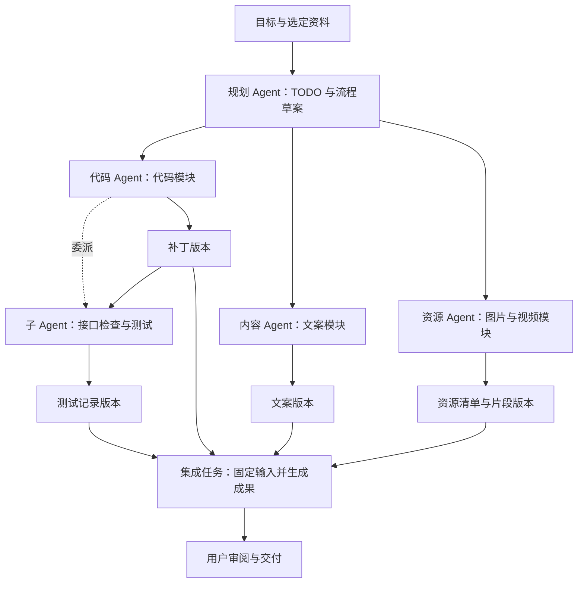

# Ravomi 产品需求：画布上的 AI 工作流与多 Agent 协作

版本：0.9 · 更新：2026-10-12 · 公司：Arcraven · 产品：Ravomi · 当前阶段：Bevy 与 React/Tauri 已有代码协作 MVP；节点对话检查点、任意历史分叉与跨机恢复待实现。

本文件定义 Ravomi 要解决的问题、产品行为、交付范围与验收标准。[README](README.md) 面向使用者和贡献者；[DESIGN.md](DESIGN.md) 规定 UI/UX；[AI_UI_RULES.md](AI_UI_RULES.md) 将设计要求转换为 AI 实施与检查规则；[品牌规范](assets/branding/BRAND.md) 规定识别系统；[开发指南](DEVELOPMENT.md) 记录实现；[AI_DESIGN.md](AI_DESIGN.md) 保留运行状态机、数据和接口契约。当前仓库已有 `app/` React/Tauri 迁移入口；AI_DESIGN 中尚未落地的历史路径和接口不能据此视为已实现。历史方案中的 Graplu 指本项目前身，来源以 [迁移说明](MIGRATION.md) 为准。

文本、图像、视频、代码和文件是同一工作流中的输入与成果；代码模块、资源模块、Agent 与子 Agent 在无限画布上共同组织。AI_DESIGN.md 保留领域契约与 G/V 需求编号，视觉需求的阶段优先级不覆盖通用协作的首发顺序；产品范围与依赖以本文为准。

“已实现”指当前工作区存在实现与相应验证，不表示跨平台正式发布；“部分实现”必须同时说明缺口；“规划”不代表已安装依赖或接入服务。本文性能指标均需单独测量，不把上游能力或测试通过当作产品承诺。

## 1. 产品定位

**Ravomi 是 Arcraven 旗下的多 Agent 画布工作空间：在无限画布上召唤并协作管理多个 Agent，将代码、素材、任务与子代理组织为可连接的模块。AI 能拆解 TODO、编排工作流程，并按需在 Agent 之间交接任务与上下文；人可以随时查看进度、介入调整，同时并行推进其他任务分支。**

核心体验是让协作**可见、可连接、可干预**：用户在掌握全局的同时，灵活推进多个工作方向。Ravomi 统一组织任务、执行者、输入、成果及其关系。外部对话应用会话、模型 API 和本地工具是执行器的不同接入方式；它们共用任务、运行、上下文和交接契约，具体功能由适配器声明。产品范围覆盖调研、编程、内容和视觉工作，不能收窄为多个聊天窗口的容器或单一图像生成工具。

桌面优先、本地项目文件是当前交付方向。用户可以从一句目标、一份资料、一个任务或一个受支持的现有会话开始，逐步扩展成工作流。画布布局帮助理解工作，但只有明确的输入选择、执行关系和授权才决定实际执行。

文本、图像、视频、代码、文件和结构化数据都可以成为流程中的元素。同一张图片可以是参考、待分析输入、生成结果或交付物；它的作用由任务和引用关系决定。调研、写作、编程和视觉创作共用任务、运行、工件、版本、权限与预算体系，各自按内容类型提供编辑和验收能力。

AI 按任务领取必要上下文并交接成果，减少单个 Agent 长期携带全部历史的负担；人在一个分支运行时，可以编排另一分支、整理资源、修改未启动任务或审阅已完成成果。调用更强模型、增加 Agent 数量或扩大自动化范围都不是默认成功标准；成果质量、交接可追溯、用户能有效介入才是产品价值。

| 核心体验 | 用户必须能回答的问题 | 可验收行为 |
| --- | --- | --- |
| 可见 | 谁在做什么，依据哪些输入，哪里被阻塞，产出了哪个版本？ | 画布和运行总览显示职责、来源、状态与待处理项；可从汇总进入具体运行 |
| 可连接 | 这条线表达关系、提供上下文，还是要求先完成另一任务？ | 关系类型与方向可辨识；运行前可检查实际输入、依赖和将接收结果的任务 |
| 可干预 | 我能否修改计划、停止一个分支、审阅成果或换一个执行者？ | 操作范围与影响清楚；保留历史和在途输入，其他独立分支继续可用 |
| 掌握全局 | 多个方向同时推进时，我下一步需要处理什么？ | 缩远看模块与汇总，选中看细节；待介入事项可定位且不抢走编辑焦点 |

### 要解决的体验问题

| 问题 | 产品行为 | 用户可以获得的改善 |
| --- | --- | --- |
| 长对话承载整个项目，任务与背景混在一起 | 按模块和任务拆分上下文，保留公共约束、版本摘要与按需读取入口 | 每个 Agent 专注当前职责，减少重复携带无关历史，能追查信息来源 |
| AI 生成的代码和图文视频资源散落在对话与目录里 | 将代码职责、文件、资源片段和产出来源显示为模块，连接任务和使用关系 | 看得见生成了什么、谁在使用、哪些版本需要更新 |
| 多个 Agent 的分工、依赖和阻塞难以追踪 | 展示父子代理、任务归属、分叉汇合与等待原因 | 可以定位停在哪一步、由谁处理、下一步需要人做什么 |
| 单窗口里等待一个 Agent，难以同时推进其他工作 | 多节点持续运行，画布与编辑保持可用，完成和待介入事项集中提示 | 等待期间仍能整理、编排、审阅和发起独立任务，不必守着一条回复流 |

三个层次按顺序建立：

1. **把图画好**：创建、编辑、连接、分组、定位和保存可靠，鼠标与触控板操作连贯。
2. **把任务跑通**：选定输入与执行器，得到可保存、可检查、可继续引用的成果；停止、重试与恢复行为明确。
3. **把流程协作好**：任务分叉与汇合，多 Agent 按角色交接固定版本的成果，在权限和预算内完成验收与交付。

普通绘图不要求配置模型、登录外部服务或理解任务调度。基础画布的发布不等待 AI 全部完成。

### 用户与使用场景

| 用户 | 核心需求 | 典型成果 |
| --- | --- | --- |
| 学习者、教师、研究者 | 组织资料，拆分问题，对照证据并汇总结论 | 知识图谱、课程结构、阅读笔记；后续扩展到调研报告 |
| 设计师、产品与项目负责人 | 发散想法、比较方案、拆分任务、审阅成果 | 方案图、流程图、项目规划；后续扩展到需求与交付流程 |
| 开发者 | 梳理模块，让 Agent 分工实现、测试和集成 | 架构图、依赖图；后续扩展到补丁、测试记录和交接包 |
| 创作者、品牌与市场团队 | 串联调研、文案、图片与交付，保留版本和审阅过程 | 内容方案、海报、品牌视觉探索、社媒套图（规划） |

### 工作流中的共同对象（规划）

| 对象 | 用户能决定什么 | 必须保持的边界 |
| --- | --- | --- |
| 任务 Task | 定义目标、输入要求、执行者和完成条件 | 描述“要做什么”；定义可修订，每次运行固定任务版本；TODO 完成条件不等于模型已返回 |
| Agent / 子 Agent | 指定职责、执行器、工具与工作范围，查看委派和汇报关系 | 描述“由谁做”；一个 Agent 可承担多个任务和运行，子代理不自动继承所有上下文与权限 |
| 运行 Run | 查看某次执行的输入、状态、用量和错误，停止或重试 | 描述“这一次怎么做”；重试创建新运行，运行中修改不改写已发出的请求；连接状态与运行状态分开 |
| 工件 Artifact | 引用文本、图片、文件、代码、结构化结果的指定版本或片段 | 输入资料与产出共用来源及版本规则；已提交版本只读，修改产生新版本；外部链接需说明是否已保存内容快照 |
| 上下文 Context | 选择本次任务实际可用的公共约束、资料片段、成果和必要摘要 | 编译成固定输入快照；显示来源、版本、选取范围和数据去向；不等于整个画布或全部聊天历史 |
| 对话检查点 ConversationCheckpoint | 将节点关联到某个固定的对话位置，查看实际保留的消息与工件 | 可编辑草稿与不可变历史分离；不保证包含外部应用未提供的背景；不同于整份项目存档 |
| 分支 Branch | 从任意检查点创建独立方向，并对比各自结果 | 共享固定历史，各自产生新 Run 与输出检查点；创建分支不自动执行，复制节点不等于分叉 |
| 交接 Handoff | 把目标、必要约束、固定成果版本、关键决定和待办交给接收方 | 保存发送方、接收方、输入包、时间与接收状态；已发出、已接收、执行成功、验收通过分别记录 |
| 对话应用节点 / 执行器接入 | 绑定可用的外部会话、模型 API 或本地工具，查看真实接入能力 | 外部会话不等于 Agent 或 Run；会话可关联多次运行，读取历史、取消和用量仅在实际支持时提供 |
| 模块 | 将代码、图文视频资源或一组任务封装成有名称、输入、输出和版本的单元 | 可展开内部对象，复用时显式绑定输入；视觉分组不自动移动文件、重构代码或启动任务 |
| 审阅记录 Review | 对指定工件版本通过、要求修改或拒绝，并记录原因 | 审阅不覆盖运行事实；新工件版本不自动继承旧版通过状态，只有受影响的审阅和下游需要重新确认 |
| 关系 | 表达普通关联、指定上下文引用或声明执行依赖 | 三类关系可辨识；普通连线、空间邻近和分组不会自动发送内容或触发执行 |

模型生成成功与用户验收通过分别记录。流程可显式等待人工验收；没有该要求的依赖可使用本次成功提交的结果，界面仍应显示其未审阅状态。

连线只是关系声明，**不自动授予执行、读取文件、传输内容、写入工作区或发布结果的权限**。运行需要满足已记录的授权范围；已有项目或模块授权可覆盖后续例行执行，无需机械地重复确认。审批、预算、输入版本或目标执行器发生超范围变化时，才进入对应的待介入流程。

### 与 Project Graph 的关系

参考 [Project Graph 的功能介绍](https://github.com/graphif/project-graph/blob/master/app/README.md)：直接拖拽连接、图结构表达、历史记录、桌面使用，以及围绕思考和教学组织的场景。Graplu 从其 Bevy 原型独立迁入，来源见 [迁移说明](MIGRATION.md)。

| 参考方向 | Ravomi 的取舍 |
| --- | --- |
| 节点、连线、分组与历史 | 作为基础编辑能力，先保障完整操作和文件往返 |
| 自动保存与备份 | 已有后台恢复副本、新草稿恢复入口及可持久化的开关/间隔/数量设置 |
| 跨平台与多语言 | 保留为产品目标；Linux 有编辑与渲染验证，Apple Silicon macOS 有原生启动、中文离屏渲染与 DMG 打包的有限验证，尚不代表完整交互验收；其他平台逐项验证，见 [macOS 说明](packaging/macos/README.md) |
| 丰富的对象与扩展生态 | 分阶段补齐；不因可读取部分文件就宣称兼容全部上游能力 |
| 高效、易用的交互 | 结合 Ravomi 的 MSDF、滚轮缓动与直接跟手的节点拖动，使用可复现的输入与视觉验收 |

## 2. 当前可用功能

以下 C/B 表默认描述根目录 Rust/Bevy 原型。`app/` 是另一个尚未功能对等的 React/Tauri 迁移入口，已接通新建、打开、文字对象编辑、历史与保存；当前主要显示对象列表，不能将 Bevy 的画布、图片、连线、恢复和导出能力一并算作 React 入口已实现。同窗口 React 原位文字编辑另有实验入口，范围见 [app/README.md](app/README.md) 与 [验收记录](validation/react-inline-editor.md)。

| 编号 | 功能 | 状态与边界 | 实现 / 验证依据 |
| --- | --- | --- | --- |
| C01 | 画布导航 | 已实现鼠标锚定缩放、滚轮缓动、中键/空格平移、全图定位；原生 Wayland 组合捏合和平移已验证 | `src/navigation.rs`、[交互调研与测试](validation/canvas-motion-research.md) |
| C02 | 文字节点 | 已实现空白双击创建、原位多行编辑、自动尺寸、手动宽度折行及常用颜色/字号/宽度属性；输入法与缩放仍需按入口验收 | `src/creation.rs`、`src/editor.rs`、`src/canvas_tools.rs`、[创建验证](validation/node-creation.md) |
| C03 | 选择与组织 | 已实现点击、多选、框选、全选、嵌套分组、整组移动、Alt 放置与当前图文字搜索；折叠已有模型、投影及部分交互回归，正式入口与完整集成待完成，对象大纲尚未实现 | `src/viewer.rs`、`src/jump.rs`、`src/canvas_tools.rs`、[整组与折叠验证](VALIDATION.md) |
| C04 | 连线 | 已实现有向连线创建、选中、删除、标题编辑和普通连线反转，显示已有普通/多目标边及标签；完整端口、曲线和属性编辑尚未齐 | `src/edges.rs`、`src/cutting.rs`、`src/canvas_tools.rs` |
| C05 | 删除与反馈 | 已实现直线切割预览、释放删除、锁定对象保护、编辑/创建/移动和连线反馈；未宣称复刻全部上游效果 | [切割验证](validation/cutting-feedback.md)、[验证汇总](VALIDATION.md) |
| C06 | 拖动推挤 | 当前源码支持可关闭的物理推挤、整组避开锁定障碍物和直接跟随指针；不对所拖对象增加弹簧或阻尼跟随，快速拖动更新扫掠碰撞范围；关闭推挤后保持直接拖动 | `src/physics.rs`；[运动验证](validation/canvas-motion-research.md) 保留各阶段测试环境与限制，历史阻尼方案不作为当前实现事实 |
| C07 | 文字与外观 | 已实现 MSDF 世界文字、系统字体回退、深浅主题、独立界面缩放；极端缩放和回退字形仍需视觉验收 | `src/msdf_text.rs`、`src/theme.rs`、[字体来源](vendor/kayak_font_msdf/UPSTREAM.md) |
| C08 | 文档与历史 | 已有新建草稿、打开、最近文件、保存/另存、撤销/重做与关闭提示；后台恢复副本及策略/恢复入口已接通，原文件仍需手动保存；保存保留受支持对象的未知字段及 ZIP 附件 | `src/home.rs`、`src/document.rs`、`src/recovery.rs`、`src/recovery_ui.rs`、[开发说明](DEVELOPMENT.md) |
| C09 | 图片与文件预览 | 文件菜单支持 PNG/JPEG/SVG 导入和系统剪贴板位图粘贴；保留文件导入的原始附件及文件名，支持撤销与图对象跨标签页粘贴 | `src/image_import.rs`、`src/document.rs`、`src/viewer.rs`、[缩略图工具](packaging/linux/README.md) |
| C10 | 图谱 PNG 导出 | 文件菜单已提供全图/选区、宽度和透明背景选项，后台渲染、取消与保存有回归；隔离 X11 流程已验收，原生 Wayland 完整流程待验收 | `src/export_ui.rs`、`src/export_image.rs`、[导出验证](VALIDATION.md) |

当前已有 Pi 文字/代码任务规划、计划内多 Agent 执行及依赖成果交接；文字任务不要求外部目录，记录随 `.mio` 保存，就绪 Agent 无固定并发或任务数量上限。运行期间动态自主委派、图像生成和任意历史检查点分叉仍待实现。当前图文字搜索不等于跨项目全文搜索，恢复副本不等于自动覆盖原文件；PNG 用户入口也不代表 SVG/PDF 或全部平台导出已验收。现有 UI 尚未完整落地本文规定的品牌与工作空间设计，概念图不能作为已实现界面的证明。

## 3. 基础画布需求

这一阶段让用户能从零开始完成一张图并可靠保存。现有能力继续打磨，缺口按下面的优先级补齐。P0 是该阶段退出所必需，P1 是后续增强，不代表同时开工。

| 编号 | 优先级 | 功能介绍与验收条件 | 当前状态 |
| --- | --- | --- | --- |
| B01 | P0 | 项目入口：新建空白、打开、最近文件、保存与另存；取消对话框不改变当前项目，覆盖/外部变更有明确处理 | 部分：新建草稿、打开/最近文件、保存/另存已有；原生文件对话框与完整恢复/关闭场景按环境验收 |
| B02 | P0 | 节点编辑：创建、重命名、多行输入、复制粘贴、删除、常用样式和尺寸；中文输入法组合输入不误触快捷键 | 部分：主要入口与回归已有；真实 IME、DPI 与不同编辑入口的完整矩阵待持续验收 |
| B03 | P0 | 关系表达：创建、选择、删除与编辑连线，支持标签、方向和端口；移动节点后端点保持正确 | 部分：创建、选择/删除、标题和普通边反转已有；完整端口/属性编辑未齐 |
| B04 | P0 | 组织与查找：嵌套分组、归组/移出、折叠展开、文字搜索和定位；操作前后成员身份与边关系不丢失 | 部分：分组、归属与当前图搜索已有；折叠模型/投影/部分交互已有，正式入口及完整集成待补 |
| B05 | P0 | 素材入口：导入/粘贴图片，保留原始附件与来源；缺失或不支持的格式显示原因 | 已实现入口与保存/撤销回归，隔离 X11 系统图片剪贴板通过；原生 Wayland 剪贴板、文件对话框完整桌面验收待补 |
| B06 | P0 | 可靠保存：自动保存、可配置备份、恢复入口与外部冲突检测；写入失败保留原文件和未保存状态 | 部分：后台恢复副本、持久化策略、恢复与逐份删除入口已有；原文件需手动保存，原生桌面另存全流程待验收 |
| B07 | P0 | 图谱导出：选择全图或选区导出 PNG，明确边界、背景与分辨率；导出不包含工具栏，不受当前缩放影响 | 已接入文件菜单、全图/选区快照、宽度与透明背景、后台渲染和原生保存；X11 全图与单节点透明选区流程已验收，取消/超时进程回收有实进程回归；原生 Wayland 待验收，SVG/PDF 另行验证 |
| B08 | P0 | 交互一致性：滚轮短缓动、触控板直接响应；多选整体拖动、可取消；推挤可关闭；编辑层和画布不争抢输入 | 部分：核心已实现，保留设备/输入法手工验收 |
| B09 | P0 | Linux 分发与帮助：可安装的桌面入口、文件关联、首次引导、快捷键帮助和兼容说明 | 部分：源码启动、帮助与独立缩略图工具已有 |
| B10 | P1 | Windows/macOS：逐个平台验证字体、输入法、触控板、文件对话框、保存和打包后再标记支持 | 规划 |
| B11 | P1 | 个性化与可访问性：快捷键重映射、多语言、降低动态效果、清晰焦点与不只依赖颜色的状态反馈 | 部分：主题和界面缩放已有 |
| B12 | P1 | 大图组织：对齐分布、自动布局、对象大纲及可复用模板 | 规划 |

### 关键交互约定

- **创建与编辑**：双击空白创建文字节点；在分组内部创建时加入最内层可写分组；锁定分组拒绝创建。双击文字节点原位编辑，进入编辑不强制改变相机。
- **确认与取消**：Enter 完成文字编辑，Shift+Enter 换行，Ctrl+Enter 兼容；文字编辑的 Esc、点击别处或滚轮保留已输入内容。画布拖动、连线和切割的 Esc 取消当前手势。
- **缩放与拖动**：滚轮以鼠标为锚点，重复输入连续衔接，反向及时响应；触控板不叠加滚轮缓动。节点直接跟随指针，锁定障碍限制整组选区的可达位置，快速移动仍需正确推挤；松手不额外抛掷，多选不散架。
- **分组与锁定**：整组移动使用同一位移；父子重复选中不重复移动。锁定对象及受保护成员不能被移动、切割或新建操作间接修改。
- **历史与保存**：一次拖动及收尾、一次编辑、一次创建或一次切割各对应一条历史记录；撤销不产生隐藏的第二次修改。首次字体测量不单独标脏。
- **输入所有权**：文字输入、弹窗或失焦时停止相关画布操作；窗口恢复后不重放已丢弃的手势。切换工具明确结束或取消当前事务。

## 4. 执行器接入与通用 AI 工作流需求（规划）

目标闭环是：**放入目标与资料 → 召唤 Agent 或选择执行器 → 定义任务与输入 → 执行并观察 → 固定成果版本 → 交接后续任务 → 审阅交付**。首版由一名本地用户控制，可以从单任务开始，不要求预先搭好整张流程图。绑定受支持的现有会话是入口之一，直接模型调用和本地工具遵守相同的输入、运行、工件与授权边界。

### 对话应用作为节点

首发代码执行按用户选择采用编译内置 Pi；Codex 保留为后续外部应用接入候选，其他对话应用逐项验证后接入。本规划不表示已有通用接口，也不承诺所有应用都可嵌入界面、读取历史或远程控制。优先使用应用公开支持的 SDK、CLI 或协议，节点提供统一任务视图，并在支持时打开原应用的对应会话。

| 编号 | 功能 | 首次交付必须满足 |
| --- | --- | --- |
| W01 | 应用与会话绑定 | 节点显示应用、账户/工作区标识、会话来源和连接状态；凭据独立存储。只有经验证的接口才提供创建或绑定入口 |
| W02 | 在节点中继续对话 | 支持的接入可提交消息、显示回复和工具进度；保留外部会话与本地运行的对应关系，重复事件不重复生成成果 |
| W03 | 选择与交接上下文 | 用户选择资料、历史片段、摘要或结果版本，预览将发送的内容；默认不复制完整会话、隐藏推理或未选文件 |
| W04 | 应用间结果交接 | 将一个应用的指定回复、文件或补丁保存为工件，再提供给另一个应用；接收方必须支持该内容类型，否则明确提示转换或手动交接 |
| W05 | 接入能力与降级 | 分别声明提交、流式输出、历史读取、取消、状态查询、工件读取和用量能力；不支持的操作不显示为可用，无法确认的状态显示未知 |
| W06 | 重连与外部变更 | 回到原应用继续操作后，按接口能力同步并保留来源；已固定快照不随外部历史变化。连接丢失不等于任务停止，不盲目重发可能产生副作用的请求 |
| W07 | 手动交接 | 无可用接口时允许粘贴选定内容、导入工件和记录会话链接；明确标记手动来源，不能伪装为实时同步或自动执行 |

首个自动接入至少验证消息提交、结果获取和会话关联；取消、查询及用量按真实能力展示。节点承载任务与会话关系，不要求将外部应用窗口嵌入画布。应用自身的审批仍需遵守，Ravomi 的授权不能代替外部应用的授权。

输入预览分别标明 Ravomi 本次发送的内容与外部会话继承的背景。无法读取的历史、应用系统提示和内部上下文标记为未知，不宣称已完整快照。要求固定输入重试时，使用经验证的新会话或分支/恢复能力；接入方无法隔离已变化的会话状态时，只能作为明确提示背景变化的新运行，不能标作精确重放。外部应用未提供用量或费用上限能力时，Ravomi 仍限制自己派发的次数与并发，但不能声称控制了应用内部所有调用和支出。

### 文本块与对话检查点（W02/W03/W14，规划）

文本块可以仅是未执行草稿，也可以引用固定对话检查点。用户从检查点新建分支，编辑新的要求并明确执行；两个分支共享历史，但分别保留输入、Run、结果和审阅。修改原文本、折叠节点或删除一个呈现不会改写既有历史。从检查点继续利用已有内容，不表示恢复原进程、外部会话全部背景或执行环境。

框选文本与 Agent 后，预览实际纳入的文字、对话范围、摘要及工件版本，允许调整范围和顺序；分组、连线和检查点父关系不自动发送全部内容。折叠组可展示固定总结和选定工件，展开查看主/子代理的具体 Run；多个分支运行时仍可编辑其他区域。比较不同基线是明确的比较任务，不能一律当成不可接受的执行冲突。

`.mio` 保存选定历史与必要内容，分享前展示引用补入的范围；重新打开保持关联完整，打开旧包不自动混入本机新运行。输入更新后根据实际采用版本提示过时，不自动重跑。Skill 继续从固定证据生成，经审阅写入代码项目 `.agents/skills/<name>/`，未来支持仅持有项目归档时追溯检查点、任务修订、成果和审阅来源。

**当前差异**：`.mio` v3 已使用 SQLite 保存画布关系、共享正文和只读流程证据，原生画布已有任务/节点绑定和折叠日志；尚无本节的节点检查点、任意分叉与完整持久实例隔离。Bevy 保存只更新当前文档明确连接流程的完整证据，重开不自动连接本机运行；现有 Skill 提炼仍依赖本机运行库。已统一的模型、迁移与 S1–S3 验收见 [存储规范第 7–9 节](STORAGE.md#7-对话检查点演进需求已纳入未实现)；本轮先完成保存基础，不新增图像能力。

### 不同内容共用的处理流程

| 内容 | 典型操作 | 交付与验收边界 |
| --- | --- | --- |
| 文本与资料 | 摘要、问答、调研、比较、写作 | 保留引用与来源版本；结果可编辑为新稿、导出并继续引用 |
| 代码与文件 | 分析、生成补丁、测试、交接 | 记录基线、文件变更与测试结果；写入受权限约束，并行写入必须隔离 |
| 图像与视觉资产 | 分析参考、生成、局部修改、排版 | 保留原图和派生关系；位图与原生可编辑对象分别标识 |
| 视频与片段 | 预览素材、选择时间范围、引用关键帧或转写，交给支持的执行器处理 | 保留源文件版本、时间范围与派生来源；生成/处理能力逐后端验证，资源组织不以完整时间线编辑器为前提 |
| 结构化结果 | 输出任务清单、表格数据或工具结果 | 按声明结构校验；无效结果可查看错误，不静默转为已通过成果 |

这些类型统一使用任务、运行、工件与版本机制，但按执行器能力逐项支持。一个执行器不能读取图片、视频、文件或结构化输入时，运行前说明原因，不静默遗漏或私自换后端。单任务可以产出多个不同类型的工件。

### 代码与资源的可视化模块

| 编号 | 功能 | 首次交付必须满足 |
| --- | --- | --- |
| W08 | 代码模块 | 将 AI 生成或导入的代码按职责组织，展示文件/符号、接口、依赖、负责 Agent、变更和测试记录；可打开对应文件或差异，并将所选模块交给后续任务 |
| W09 | 图文视频资源模块 | 展示文字摘要、图片缩略图、视频封面/时长与选定片段；关联原始文件、内容版本、生成任务和使用方；可组合、替换版本、预览和交接 |
| W10 | 组合与复用模块 | 将资料、任务、Agent 角色配置与成果组织为可展开的子图，定义对外输入和输出；保存为模板并在新实例中绑定资料、执行器和工作区，实例间不共享可变运行状态 |

代码模块以实际工作区文件和固定代码版本为依据，画布保存映射与引用；AI 建议的模块划分和依赖必须标明“建议/待验证”，不能伪装为已验证的代码结构。拖动、分组或重命名展示模块不自动修改源码。执行重构时创建独立任务，展示补丁并遵循原有写入与审阅规则；源码发生变化时标记对应映射和测试记录是否过期。

资源模块保留原始字节和来源；文字片段、裁剪图、视频时间范围、关键帧与转写分别记录选择或派生方式。下游已运行任务继续引用旧版，待执行任务显示可更新的来源，更新后重新固定输入。格式不支持、缺少解码能力或素材不可访问时保留来源并说明原因，不显示为已成功处理。

同一成果可以在多个模块中引用而不复制身份。展开/折叠模块仅改变视图；模块模板保存定义与必要的资源引用，不携带运行中的会话控制凭据，也不在放上画布时自动执行。

G/V 编号延续 [AI 详细设计第 5 节](AI_DESIGN.md#5-功能需求目录)；W01–W07 为应用接入需求，W08–W10 为模块需求，W11–W15 为下节的编排与观测需求。后续详细设计需补齐 W 系列契约，不能将旧执行器草案视为已覆盖这些能力。

## 5. 任务与多 Agent 协作需求（规划）

绘图中的普通关系边不自动成为可执行依赖。用户直接编排，或让 AI 在已授权范围内创建任务与执行关系后，系统才编译计划；在画布上靠近或放入同一分组不等于共享全部上下文。

| 功能组 | 功能介绍与验收边界 | 详细需求 |
| --- | --- | --- |
| 单任务执行 | 分离任务定义、一次运行和结果快照；支持流式反馈、停止、失败说明和固定输入的重试 | G02–G04、G14、G21、G32 |
| 显式上下文 | 选择来源、片段、版本与顺序；提交后固定输入，运行中编辑来源不偷偷改变请求 | G05–G09、G23、G25 |
| 有界流程 | 依赖判环、并发配额、分叉与汇合；首版汇合等待全部必需结果成功，失败有可定位的阻塞原因 | G24 |
| 自动 TODO 与流程搭建 | 从目标或结果拆分 TODO，生成任务节点、角色分配、输入和依赖；建议、自动建图与自动执行分别控制 | G22、W13 |
| Agent 分工与交接 | 为分组配置角色、工具、执行器和工作区；交接指定工件版本、来源与验收记录 | G26–G27 |
| 文件协作 | 首次并行文件写入即提供工作区隔离；集成前检查基线和用户修改，冲突可审阅 | G29 |
| 权限、预算与恢复 | 执行、工具副作用和结果验收分别记录；约束调用、时间、并发与费用；未知状态不盲目重试 | G30–G33 |
| 运行观测与缓存 | 展示状态、输入输出、耗时和提供方用量；未上报值显示未知，缓存失败回到同一输入 | G23、G28 |

运行状态机、快照、幂等、输入编译、存储恢复及跨 Agent 协议见 [AI 详细设计](AI_DESIGN.md)。自托管 KV 与跨块缓存融合属于实验项，不阻塞单任务或流程交付，也不承诺固定节省比例。

### 在画布上召唤与编排 Agent

| 编号 | 功能 | 首次交付必须满足 |
| --- | --- | --- |
| W11 | 召唤多个 Agent | 在空白处、模块或任务上创建 Agent 节点，选择角色、执行器、工作区与输入；可给不同 Agent 分配任务，同一执行器接入可承载多个独立执行者，并发受配额约束 |
| W12 | 子 Agent 与委派 | Agent 可在允许范围内派生子 Agent，展示父子关系、任务归属、输入包、进度与返回成果；限制总数、层级和预算，父任务汇合时只接收约定成果 |
| W13 | 自动 TODO 与工作流 | 从自然语言目标及已有模块生成带完成条件的 TODO、任务依赖、输入输出和执行者配置；可预览、编辑、采纳或按预授权自动创建，执行前检查判环、缺失输入、接入能力与预算 |
| W14 | 按任务分配上下文 | 每个任务使用公共约束、相关模块、指定成果版本和必要摘要；可展开来源并按权限补读，超限时明确处理，不默认复制父代理或整个项目的完整对话 |
| W15 | 并行工作与运行总览 | 同时展示各节点状态、当前任务、阻塞原因、最近活动及待介入事项；某 Agent 运行时其他模块仍可编辑、审阅和启动独立任务，切换焦点不停止后台任务 |
| W16 | 框选协作流程并整理为 Skill | 框选多个 Agent，预览实际纳入的任务、运行与成果版本，汇总目标、分工、依赖、交接、关键决定及验收方法；将可复用步骤参数化为可编辑的 Skill 草稿，经用户审阅后保存到当前项目的 `.agents/skills/<name>/SKILL.md` |

### 从多 Agent 选区沉淀 Skill（W16，核心生成与保存已接入）

2026-10-12 代码子集：原生画布框选 Agent 节点或使用列表多选，预览并删减固定 Run 清单，调用内置 Pi 生成可编辑 Skill，审阅后新增项目内 `.agents/skills/<name>/SKILL.md` 与 `references/ravomi-provenance.json`。已实现失败/在途状态标注、缺失版本拒绝、同名不覆盖和目录符号链接检查；未实现已有 Skill 的差异合并、自动复用和子图模板。证据见 [画布协作验收](validation/canvas-ai-workflows.md)。

用户框选区域内的多个 Agent → 调整纳入清单与运行版本 → 生成任务总结及工作流说明 → 将项目特定输入抽为参数 → 预览并编辑 Skill → 保存到当前项目 → 在新任务中重新绑定输入并使用。提供多选列表作为键盘与无框选入口的替代；普通框选本身不调用模型，也不自动安装 Skill。

- **范围**：以实际选中对象和用户选定的 Run / 工件版本为准。列出跨选区依赖，用户可纳入指定版本或声明为外部输入；隐藏节点、完整聊天历史、凭据和未选文件不自动加入。
- **总结**：保留目标、Agent 职责、执行顺序、并行与汇合、子代理交接、有效做法、失败尝试、未解决问题与人工审阅结论，并能回溯来源。仍在运行或缺失结果时标注“不完整”，不编造成功经验。
- **Skill 产物**：包含名称、适用条件、输入参数、前置条件、分步流程、角色与上下文分配、输出、验收方法、失败处理和权限边界；引用材料放入同目录 `references/` 并保留来源与许可证。区分操作说明 Skill 与可执行子图模板，文档生成不表示调度计划已验证。
- **保存与复用**：先展示草稿与目标路径，允许修改或取消；只安装到当前项目 `.agents/skills/`，禁止默认写入用户级或全局目录。同名版本展示差异，不静默覆盖。复用时重新选择资料、执行器与授权，不复用旧凭据、活动 Run 或会话控制权。
- **交付阶段**：任务总结依赖 R4 的可追溯运行；完整 Skill 沉淀与复用纳入 R5，不阻塞 R2 + R4 的核心协作 MVP。

Agent 父子关系、任务执行依赖、模块包含关系分别表达。外部应用提供原生子代理接口时按实际事件映射；没有该能力时，可由 Ravomi 通过已支持的接口创建独立执行者并记录委派关系，不能把不可观测的内部子代理显示成可控节点。子代理权限不超过父任务授权，并可进一步缩小。

自动化分为“给建议”“自动创建或更新待执行计划”“自动执行”三个独立策略。用户可为项目或模块预先设定范围，在范围内自动推进，无需逐条确认；扩大权限、预算或外部副作用范围时沿用授权规则。自动生成的计划保存版本和来源，重复事件不重复造任务；用户忽略或完成的 TODO 不因重新规划无故复活。调整计划不覆盖在途运行或已提交成果，修改已固定的待执行项需重新编译和校验。

父任务停止派发后不再创建后代；用户可明确选择停止当前运行或整条委派分支。停止分支时对已运行后代逐个请求取消，不支持取消或尚未确认的节点保持运行/停止中/未知，不能提前把整组标成已停止。失败分支保留成果和错误，由用户或授权策略决定重试、替换执行者或修订计划。

上下文拆分以降低单个 Agent 的无关历史负担为目标。交接包包含任务目标、必要约束、成果引用、关键决定、未解决问题和验收记录；摘要有来源版本，接收者可按需读取原文。公共约束不可为省 token 被静默删去。分别测量单 Agent 上下文峰值、整个流程输入/输出用量、重复读取、交接开销及结果质量；多 Agent 不保证总 token 或总费用下降。

### 上下文复用与缓存

同一需求、规范、资料或接口说明会被多个节点重复使用。Ravomi 负责确定可共享的内容、版本和权限；应用适配器及推理后端负责执行与可用的缓存优化。跨应用交接默认传递可检查的内容工件，缓存失效或应用不暴露缓存能力时仍可完成同一任务。

| 层级 | 产品能力 | 适用条件与边界 |
| --- | --- | --- |
| C0 内容复用 | 复用资料、摘要和成果快照，编译确定的输入包 | AI 工作流基础；本地保留内容不代表外部模型已处理，也不保证命中缓存 |
| C1 应用/云端缓存 | 尽可能保持稳定输入，展示接入方实际报告的命中和用量 | 适配器支持时提供；外部应用自行组装上下文的部分不可假定受 Ravomi 控制，未上报显示未知 |
| C2 自托管前缀 KV | 在兼容推理后端复用公共前缀，评估 SGLang、Mooncake 等 | 可选实验；由独立服务管理 KV，需模型、模板和权限兼容，不要求用户桌面管理显存 |
| C3 多块融合 | 评估多来源资料的缓存融合与必要重算 | CacheBlend 等独立实验；验证正确性、质量与净收益后再决定是否发布 |

缓存论文的研究对应为：SGLang 关注前缀复用，Mooncake 关注分布式 KV 存储和传输，CacheGen 关注缓存压缩传输，CacheBlend 关注多块融合；DeepSeek MLA、DistServe 和 Splitwise 为模型与服务架构选型提供参考。研究索引见上游 `project-graph/kvcache-sharing-research/README.md`，Ravomi 内的边界与契约见 [AI 详细设计第 9 节](AI_DESIGN.md#9-上下文编译与缓存设计)。这些方案不作为已选依赖或对任意对话应用的能力承诺。

不同应用或模型之间没有默认可交换的 KV。汇合任务先固定各分支的内容结果并编译输入，不能把流程连线解释为拼接模型记忆；缓存也不能代替持久化快照。费用按接入方实际用量和计价记录，文本处理缓存收益不直接等同于图像生成收益。

### 视觉创作作为工作流场景

保留海报、品牌视觉探索和社媒物料的专项需求：**需求与参考 → 候选生成 → 编辑定稿 → 多尺寸派生 → 审阅导出**。这些任务复用通用运行与交接机制，图像可与调研报告、文案、代码或网页成果共同进入后续任务。完整视觉编辑器不作为文本工作流、对话应用接入或工程协作的前置条件。

| 功能组 | 用户能做什么 | 首次交付必须满足 | 详细需求 |
| --- | --- | --- | --- |
| Brief 与参考板 | 放入目标、受众、固定文案、参考图与约束 | 可看到实际选中的输入；未选素材不发送给模型 | G01–G06、V02–V03、V16 |
| 品牌资产 | 复用 Logo、字体、色值和品牌规则 | 固定使用的品牌版本；精确文案和 Logo 不靠模型重画 | V04、V07 |
| 候选生成与局部修改 | 生成多个方向、框选或圈选后修改 | 展示目标、参考范围与预计作业数；失败候选可独立重试，旧稿保留 | V05–V06、V16 |
| 原生图层与画板 | 编辑文字、图片、Logo、基础形状、层级和裁剪 | 修改日期不重新生图；生成位图不冒充可编辑原生图层 | V07–V08 |
| 版本与审阅 | 并排比较、采纳候选、恢复旧版、留下意见 | 意见绑定具体版本与区域；恢复生成新草稿，不覆盖历史 | G07–G09、V09、V12 |
| 多尺寸与交付 | 从母版派生三个自定义尺寸，导出 PNG/JPEG、源文件与清单 | 保留必要文案和 Logo，不机械拉伸；按尺寸报告成功或失败 | V10–V11 |

后续增强包括模板套图、条件 SVG/PDF 导出、抠图、扩图、超分和品牌检查（V13–V14）。自动拆层与复杂矢量重建（V15）单独验证质量。视频时间线、3D、广告投放、印刷级 PDF-X 和完整 Photoshop/Illustrator 替代不在该场景首发范围。

## 6. 信息架构与用户旅程

### UI/UX 产品准则

视觉方向为**清晰、安静的工作界面，配合迷幻、神秘而克制的 Agent 形象**。参考 Arc Browser 的空间层级、低饱和外壳与内嵌工作区：浅灰紫外壳、暖白主画布、明确留白、薄分隔和高可读文字。弥散色与细颗粒柔光集中在小猫和少量品牌展示中，不能扩散到正文、控件、连线或大面积工作背景。

小猫采用石墨黑的单一团子轮廓、两只耳朵、两只眼睛；雾蓝紫只在局部边缘提供细颗粒柔光。没有嘴巴、鼻子、胡须、尾巴、脚或其他肢体。小尺寸版本优先保持轮廓与双眼，细节不足时简化材质。品牌的神秘感不能降低状态辨识、文本对比度或操作确定性。具体色值、尺寸、素材与状态验收遵循 [DESIGN.md](DESIGN.md)、[BRAND.md](assets/branding/BRAND.md) 和 [AI_UI_RULES.md](AI_UI_RULES.md)，本节不另建一套设计 token。

以下为目标工作空间的职责划分，属于设计规范，不能据此声称现有原型已经实现：

| 区域 | 首要职责 | 交互边界 |
| --- | --- | --- |
| 侧栏 | 切换工作空间、项目、画布与 Agent/成果视图，展示少量需处理事项 | 避免重复堆放所有任务与所有工具；收起后保持返回当前画布的路径 |
| 主画布 | 组织模块、任务、Agent、成果与有语义的连接；逐级展开细节 | 缩远保持标题和汇总状态可识别；装饰不覆盖内容，不强制布局全部回复 |
| 节点 / 模块 | 展示名称、职责、当前任务、文字状态与关键成果 | 渐进展开详情；小猫不代替名称、角色或状态；未知进度不显示虚假百分比 |
| 详情面板 | 检查选定对象的输入、执行、成果、交接与活动，提供下一步操作 | 对象身份与版本始终清楚；关闭面板不停止任务；审阅针对明确版本 |
| 全局输入 / 召唤入口 | 从目标、选区或模块创建任务和 Agent，调整计划 | 发送前说明作用范围；输入文字不自动授权访问整个项目 |
| 运行总览 | 定位进行中、待介入、失败与新完成的分支，按范围暂停派发或停止 | “暂停派发”和“停止已运行任务”分别命名；批量操作显示数量与影响范围 |

可访问性与可操作性是验收要求：使用颜色加文字/图标表达状态，键盘焦点可见；缩放、窄窗口和长中文内容不遮挡关键操作；运行消息不抢焦点；降低动态效果时保留同等信息。错误说明发生了什么、哪些成果仍保留，以及可以采取的下一步，避免只显示“失败”。

### 基础画布

新建草稿或打开已有项目 → 创建和编辑节点 → 连线 → 框选分组 → 调整位置 → 撤销检查 → 另存为 → 关闭重开确认。已有 PNG 入口按支持环境导出，B01/B07 仍按完整验收条件收尾。

工具栏承载文件操作、选择、分组、连线、主题与帮助；画布承担直接操作；状态区显示缩放、选择数量、保存与物理状态。日常操作不展示渲染器、图集页或内部任务 ID。

### 从目标到协作流程

用户放入目标或资料，召唤一个负责当前任务的 Agent，检查职责、输入与完成条件后执行。也可以绑定受支持的已有应用会话，在详情中继续交流，选择回复或文件形成成果。需要更多协作时再连接资料、其他 Agent 和汇总任务；单次任务不要求用户配置底层调度参数。

也可以在画布上选中一组代码、图文或视频资源，输入目标并召唤负责规划的 Agent。它将 TODO、建议的模块划分、执行角色和依赖呈现在画布上；用户可直接修改，也可预授权在限定范围内自动搭建并执行。缩远时看模块、分工和汇总状态，放大或展开时看子任务、子 Agent、具体输入与成果，不要求把完整回复流同时铺满画布。

未来“内容”视图突出资料、对话与成果，“流程”视图展开任务、依赖与运行状态。选中图像成果时提供对应预览或画板编辑，选中文本或代码时提供相应内容视图。两种视图共享对象身份、版本和历史，切换不复制资产、不触发执行。执行、权限与费用信息在确认和排错时可见。

通用验收故事为：选定需求和资料 → 规划 Agent 形成方案 → 固定方案版本交给代码 Agent → 生成补丁与测试记录 → 审阅 Agent 检查 → 用户采纳或发起修改。Codex 等受支持的应用可以承载对应执行者。每次交接都能查到实际输入；修订方案或补丁时产生新版本，先前运行仍指向旧版本。文本调研与汇总也应能独立完成整条流程，不需要任何图像节点。

分叉协作以“两个 Agent 独立产出、集成任务固定双方结果并审阅”为样例；视觉场景以“一份需求、三个方向、一张定稿、三个尺寸”为专项样例。已有故事及异常分支保留在 [AI 详细设计第 4 节](AI_DESIGN.md#4-两条贯穿用户旅程)，不能用单个视觉样例替代通用工作流验收。

### 多模块并行工作的贯穿故事

用户准备制作一个介绍页，将需求、现有代码、文案、图片和视频放上画布，召唤规划 Agent。系统建立代码、内容和媒体模块，生成 TODO 并派发独立任务；代码 Agent 可再委派一个子 Agent 检查接口或测试。集成任务只接收固定版本的补丁、文案与媒体清单，不需要复制每个执行者的全部聊天记录。

代码分支运行时，用户可在同一画布继续挑选视频片段、审阅文案或召唤另一个独立 Agent。某分支等待授权或失败时，其余无依赖分支继续；关联的集成任务显示具体等待项。修改媒体选择只影响明确采纳新输入的后续任务，不偷偷改变已运行的代码任务。

### 运行期间的交互

- 任务的未就绪/就绪与 Run 的状态分别记录。UI 可汇总展示未启动、等待依赖、排队、运行、待用户介入、产物待保存、成功、失败、停止中、已停止、中断或未知；每种状态附文字与原因。真实进度未知时显示当前步骤或最近活动，不编造百分比。
- 总览集中展示正在运行、等待处理和新完成的任务；父 Agent/模块的汇总能展开到子任务，局部成功不冒充整组完成。
- 完成和待处理提示可定位节点，但不抢占正在编辑的焦点或自动移动相机；用户可选择关注某个分支。
- 切换节点、折叠模块或关闭详情面板不取消运行；项目/应用关闭沿用明确的停止与恢复能力，不因“后台运行”承诺应用退出后仍继续。
- 编辑锁定范围限定在实际冲突的对象和事务；一个 Agent 的流式回复或等待不能锁住整张画布。影响在途输入的修改以新版本保存，后续运行显式采用。

| 用户意图 / 状态 | 产品必须执行的行为 | 后续影响 |
| --- | --- | --- |
| 暂停派发 | 暂停所选流程或分支的新任务派发，清楚显示作用范围 | 已运行任务继续；恢复派发前重新校验依赖和授权，不把暂停显示为全部停止 |
| 停止当前运行 | 向实际执行器请求取消，显示“停止中”；确认取消才显示“已停止” | 不支持取消或无法确认时显示限制/未知；已发生的文件副作用和费用不会被撤销 |
| 停止委派分支 | 先停止后续派发，再逐个处理正在运行的后代 | 展示各项真实结果；无依赖的其他分支继续，已保留成果可查看 |
| 失败后重试 | 保留失败运行，以固定输入和配置创建关联的新 Run；背景无法隔离时明确列出变化 | 不覆盖原记录，不盲目重发状态未知或可能重复副作用的请求 |
| 产物待保存 | 继续同一次结果下载、校验与持久化 | 不重新调用模型；恢复失败说明可保留的内容与可选处理 |
| 人工审阅 | 显示具体工件版本、差异与验收条件，提供通过、要求修改或拒绝 | 通过只满足该版本的审阅门槛；要求修改创建后续任务/版本，旧记录保留 |
| 替换输入或修改计划 | 保存新版本，列出直接和传递受影响的下游 | 在途运行继续使用原快照；待执行项重新编译，完成成果标记来源已更新，不自动覆盖或重跑 |
| 断连 / 重启恢复 | 根据持久化标识查询执行器，展示可确认的状态与最后活动 | 断连不等于停止；恢复前不重复提交，无法查询时提供人工核对路径 |

节点运行成功、成果已保存、人工审阅通过和整个模块完成是不同事实。汇合任务只在必需依赖及其审阅门槛满足后就绪；可选输入缺失需事先声明处理策略。一个失败、待授权或过期的分支只阻塞真正依赖它的下游，不能导致全画布停摆。具体状态枚举及合法迁移以 [AI_DESIGN 第 8 节](AI_DESIGN.md#8-运行状态机与调度) 为准。

## 7. 实现与数据边界

| 层次 | 当前实现 | 后续原则 |
| --- | --- | --- |
| React/Tauri 迁移入口 | `app/` 使用 React + TypeScript / Tauri 2，复用 `src/session.rs` 文档命令；已有 Linux 原生对象编辑与文件往返验证 | 先迁移并验证实际桌面能力；Windows/macOS、移动端与浏览器各自验收后再声明支持；浏览器需 WASM/服务端及存储适配，不能直接调用 Tauri |
| Bevy 桌面画布 | Rust、Bevy 0.19.1；世界文字使用本地维护的 Kayak MSDF，主界面沿用 egui；React 同窗口原位文字输入为独立可选入口 | 领域事实独立于渲染实体；保留可复用的文档与渲染能力，迁移期间按入口记录功能与验证，不能把 React 对象列表当成画布已迁移 |
| 文档 | `.mio` 版本化项目包，含 MessagePack 画布、资产与明确选定的只读协作历史；`.prg` 保留兼容读写，见 [存储规范](STORAGE.md) | 格式转换与降级边界明确；画布撤销栈不等于持久化运行历史，归档不自动执行 |
| 输入与物理 | Winit 设备事件、Avian 固定步、Lyon 路径 | 优先复用现有库；维护指针锚点、输入所有权、整组选中与事务一致性 |
| AI 与运行存储 | `src/collaboration/` 调度与版本化 JSON；Pi Agent Core / Pi AI 1.0.4 编译内置，代码提案与显式测试入口；Tauri 已支持明确附加流程归档 | SQLite 事务、对话检查点、完整审阅历史及实例隔离待实现；来源与导出契约见 STORAGE |
| 对话应用接入 | 尚未接入 | 分离应用会话、任务、运行与工件身份；每个适配器提供能力矩阵、连接恢复和实际接口验证记录 |
| 模块与委派关系 | 代码计划中的独立 Agent、显式父子检查任务、DAG 与来源 Run；空间模块待实现 | 动态委派和通用模块映射后续实现，画布布局不改写领域身份与执行状态 |
| 上下文与缓存 | 固定选定源码与上游代码版本；缓存尚未接入 | 可失效缓存提示与项目数据分开存储，接入方未知指标保留未知 |
| 导出 | Bevy 已有面向用户的 PNG 全图/选区入口及隔离 X11 验收，另有调试截图；React 入口未迁移 | 固定边界、版本、尺寸和字体；按格式、入口及平台分别验收，不用调试截图替代用户流程 |

上游模块可用于理解历史行为和领域契约，不能直接当作本仓库已有能力。React/Tauri 已接入代码协作，完整空间画布与 Agent 空间连线仍待迁移。AI_DESIGN.md 中的 TypeScript 接口是完整契约草案；本轮按用户决定采用编译内置 Pi，Fabric.js、Konva 和缓存后端等旧候选不表示已采用。实际范围以 [代码 MVP 验证](validation/code-collaboration-mvp.md) 为准；本轮明确不做图像功能。

`.prg` 文件兼容不保证不同字体引擎逐像素一致。缺字、缺失素材、不支持对象或保存失败应通过界面说明；不能静默丢弃后显示成功。基础绘图无需模型连接，未来外部调用须显式展示数据去向，凭据不进入项目导出包。

项目保存在本地不代表外部应用的运行也在本地。适配器必须说明数据发送对象、会话或工作区绑定，以及可读取和可写入的范围。项目导出携带用户选择的工件快照与来源记录，不携带账户凭据或可继续控制外部会话的秘密；接收者重新绑定后才能执行。仅保存外部链接的内容需标记可用性限制。

## 8. 分阶段交付

| 阶段 | 范围 | 退出条件 | 当前状态 |
| --- | --- | --- | --- |
| R0：画布原型 | C01–C10 的现有实现与回归 | 受支持教程可打开、编辑、整组移动、撤销和保存重开；记录设备与格式限制 | 已有原型，持续修正 |
| R1：日常绘图 | B01–B09 的缺口与目标 UI 基础 | 从空白完成一张图，搜索整理、保存恢复、导出分享；Linux 安装流程可复现；清晰状态、焦点与缩放达到设计验收 | 部分实现，按入口补齐与验收 |
| R2：单任务闭环 | W01–W03、W05–W09，以及通用运行、输入与存储契约 | 首发采用编译内置 Pi；输入选择、执行、成果、重试及重开关联通过；外部会话接入另验继续对话；取消/查询按能力展示 | React/Tauri 代码子集已实现；通用外部会话和完整领域契约待补 |
| R4：多 Agent 与有界工作流 | G21–G25、G30–G33、W04、W11–W15 | 先通过双 Agent 独立分支与固定版本交接，再通过 TODO 计划、子代理委派、分叉汇合、预算与恢复；运行期间可操作其他模块；Fake 与真实执行器均验收 | 代码 MVP 已接通，独立临时目录与审阅导出；空间画布集成、动态委派及平台矩阵待补 |
| R5：多执行器协作与模块复用 | G26–G29、W01–W16 | 至少两种真实执行器完成交接；组合模块可复用，双 Agent 隔离产出与集成冲突可审阅；框选多个 Agent 后可追溯总结并生成、审阅、项目内保存及复用 Skill；重连和缓存统计按能力提供 | 规划，依赖 R4 |
| R3：视觉工作流扩展 | V 系列视觉专项契约 | 三方向、原生图层、局部修改、品牌、多尺寸、版本审阅与交付闭环通过 | 规划，依赖 R2 的执行与存储；可与 R4/R5 独立推进 |

B10–B12 可随基础画布成熟独立推进；每个平台通过自身验证后再发布。R 编号保留既有引用，主线顺序为 R1 → R2 → R4 → R5，R3 为场景扩展。AI_DESIGN 的 M 阶段细化领域实现顺序，R 阶段描述产品退出条件；二者不按编号一一对应。复杂自动分层、自托管 KV 等属于实验范围，按独立报告决定是否进入产品。

通用 AI 协作 MVP 要求 R2 + R4 闭环通过，包含多 Agent 并行、子代理委派、固定版本交接、人工介入和运行期间持续可操作。R5 单独验收多执行器接入与组合模块复用，R3 单独验收完整视觉创作。R2 可先交付单任务试用，不宣称已具备多 Agent 自动协作。G/V 的优先级只对各自阶段适用，完整视觉编辑器、跨应用广泛接入和缓存实验均不作为核心协作首发前置条件。此处没有承诺发布日期或未经测量的帧率。

MVP 的最小贯穿验收场景是“一份目标、两条并行分支、一次子代理委派、一个固定版本汇合、一次人工审阅”：规划 Agent 拆分有完成条件的 TODO；研究与实现 Agent 分别处理选定输入；实现 Agent 委派一个受限检查任务；用户在运行中修改第三个独立模块。一个分支失败后其他分支继续，汇合明确等待缺失项；用户重试失败项并审阅新版本后，汇合产出可追溯成果。全程无需图像节点，也不能通过预填静态状态模拟执行成功。

## 9. 验收与发布标准

| 领域 | 必须检查的场景 | 通过条件 |
| --- | --- | --- |
| 导航与显示 | 鼠标滚轮反向、不同刷新率/DPI、原生组合手势、中文与符号缩放 | 锚点稳定、无旧手势重放、无明显缺字或残片；记录回退边界 |
| 编辑与组织 | 输入法、多行、框选嵌套组、快速拖动、锁定障碍、松手及失焦 | 无误触，成员相对位置保留；拖动直接跟手，松手不额外抛远；选择/边端点与显示一致 |
| 文档与撤销 | 创建、移动、切割、编辑各自撤销/重做；保存重开；外部变更、写入失败 | 一操作一历史；对象身份与必要附件保留；失败不覆盖原文件 |
| 可靠性缺口 | 自动保存/恢复、空白项目、搜索、折叠、导出 | 对应 B 项通过前保持“规划/部分实现”，不能用调试命令代替用户入口 |
| 应用节点 | 首个应用的消息与结果、外部会话关联、重复事件、断连重开和能力缺失 | 可定位原会话；不会因断连重复提交，未支持操作不可用，未知状态不伪装为成功或已停止 |
| 对话检查点与分叉 | 普通草稿、同检查点双分叉、输入范围选择、保存重开、旧格式迁移和复制导入 | 草稿不篡改历史，分支互不污染；实际发送与预览一致；引用完整、损坏明确失败；复制不接管原实例；未选历史不因闭包自动分享 |
| 代码模块 W08 | AI 产出代码、建议依赖、外部文件改动、代码与测试版本不一致 | 可定位实际源码和差异，建议与已验证结构有区别，过期状态可见；布局操作不改写源码 |
| 资源模块 W09 | 文字/图片/视频导入与派生、视频片段交接、替换源版本、缺失素材 | 原始内容和片段范围可追踪，支持格式可预览；旧任务保留旧版，无法处理时说明原因 |
| 组合模块 W10 | 折叠展开、两个模板实例、修改一实例、重新绑定输入 | 展示变化不触发执行，实例运行互不污染，外部输入输出明确，凭据不随模板复制 |
| Agent 与子 Agent W11–W12 | 同应用多个 Agent、父任务委派、子任务失败、超配额和停止分支 | 分工与父子关系可见，后代受预算和权限约束，取消逐项确认，其他独立分支不被误停 |
| 自动流程 W13 | 从目标建 TODO 和依赖、重复规划、人工改图、依赖环和缺失输入 | 有完成条件与计划版本，不重复造任务；策略内可自动推进，错误计划不派发，在途输入不被改写 |
| 上下文分配 W14 | 大任务拆分、父子交接、摘要缺信息、按需补读 | 每任务实际输入可检查，公共约束与来源保留，超限可处理；不默认复制完整历史 |
| 持续可操作 W15 | 至少两个 Agent 运行时编辑独立模块、审阅成果、启动另一就绪任务 | 画布不被全局锁定，焦点不被提示抢占；状态可定位，切换视图不停止任务 |
| 工作流沉淀 W16 | 多 Agent 框选/键盘多选、跨选区依赖、失败或在途运行、草稿修改/取消、同名 Skill 和新任务复用 | 输入清单可检查，结论关联固定版本；不完整状态明确；参数替代旧项目数据；只写项目技能目录，保留来源且不静默覆盖，生成 Skill 不触发执行 |
| 通用工作流 | 不含图片的调研汇总、文本/文件/结构化结果交接、输入版本修订和人工审阅 | 可从输入走到导出；每个成果有来源和运行，旧快照不变，未选资料不发送，生成与验收状态分别记录 |
| 跨应用协作 | 一应用的结果交给另一应用、外部会话继续修改、手动接入和重新授权 | 固定交接版本，接入能力与人工步骤明确；不隐式共享全部会话、凭据或工作区 |
| 视觉工作流 | 输入范围、原生文字、蒙版坐标、并发返回、版本、三尺寸交付 | 可编辑部分真实可编辑；旧稿保留；输出与所选版本、尺寸一致 |
| 任务协作 | 失败、重复/乱序事件、断流、停止未确认、预算耗尽与文件冲突 | 结果不重复提交、费用/副作用不盲目重试、阻塞原因可见 |
| 人工介入与下游影响 | 修改已使用的输入、要求返工、暂停派发、停止一个委派分支、替换执行者 | 列出受影响下游，保留在途快照和历史版本；仅在用户采纳或适用的预授权策略内重跑；其余独立分支不被误停 |
| 视觉与交互规范 | 素净工作区、品牌小猫、长中文、深浅主题、缩放、窄窗口、键盘焦点与降低动态效果 | 氛围材质局限品牌区域，文字/连线/控件清晰；双眼团子猫无多余解剖特征；重要状态与操作不只依赖颜色或动画 |
| 上下文与缓存 | 移除引用、缓存未命中/过期/不兼容、接入方不报告用量 | 新运行只使用其已固定输入；缓存故障仍可从同一快照执行；未知指标不填零，工件不依赖缓存存活 |
| 性能与平台 | 固定机器、文件、像素尺寸、DPI、字体、冷热缓存与功能开关 | 报告加载时间、帧间隔分布和内存；不以独立原型 FPS 宣称完整应用加速比 |

当前验证命令与环境要求遵循 [AGENTS.md](AGENTS.md) 和 [开发指南](DEVELOPMENT.md)。功能状态更新必须附实现与验证依据；历史图片或旧测试数量不能替代本次改动验证。AI 的详细验收案例仍使用 [AI_DESIGN 第 18 节](AI_DESIGN.md#18-验收矩阵) 的 A/D 编号。

### 产品效果的验证

| 目标 | 对照与记录 | 判定原则 |
| --- | --- | --- |
| 降低单 Agent 上下文负担 | 固定任务、模型、输入资料和质量标准，对照单会话与模块化流程，记录各 Agent 输入上下文峰值、全流程用量、重复内容及交接开销 | 同时报告质量与失败/重试；只有实测改善才声明收益，接入方不可观测的数据保持未知 |
| 等待期间可继续工作 | 在可控长任务运行时，让用户编辑另一模块、审阅一个结果并发起独立任务，记录完成情况、响应延迟、焦点中断和状态定位时间 | 三类操作均能完成；不得因模型尚未返回而阻塞无依赖操作 |
| 自动编排可检查且可收束 | 使用固定目标验证 TODO、模块输入输出、依赖、角色分工和完成条件；注入失败、预算耗尽与用户修订 | 用户能理解和修改计划，系统在边界内推进并明确报告阻塞，不靠无限派生或全历史复制完成任务 |

## 10. 文档与范围维护

- README 只突出当前可用体验，把未来能力明确放进路线表。
- PRD 记录功能状态、边界、优先级和退出条件；UI/UX 规则放 DESIGN，品牌资产放 BRAND，AI 执行界面规范放 AI_UI_RULES；实现细节放 DEVELOPMENT，运行与数据契约放 AI_DESIGN。
- AI_DESIGN 后续按本文补齐应用适配器、外部会话身份、代码/资源/组合模块、代理委派、自动规划、上下文分配、运行观测与 Skill 沉淀契约；保留 G/V 编号，并将 W01–W16 验收映射到详细设计。旧文档的视觉优先叙述不覆盖本文的工作流定位。
- 修复和功能按独立可回退提交交付；文档更新不等于该功能实现。
- 首先验证基础画布的日常使用闭环，再交付单任务、多 Agent 并行与有界工作流，按场景扩展内容编辑能力。React/Tauri 迁移复用已有文档与 Bevy 经验；逐项记录复用、迁移和暂未迁移范围，不因技术路径变化重复宣称已交付能力。
