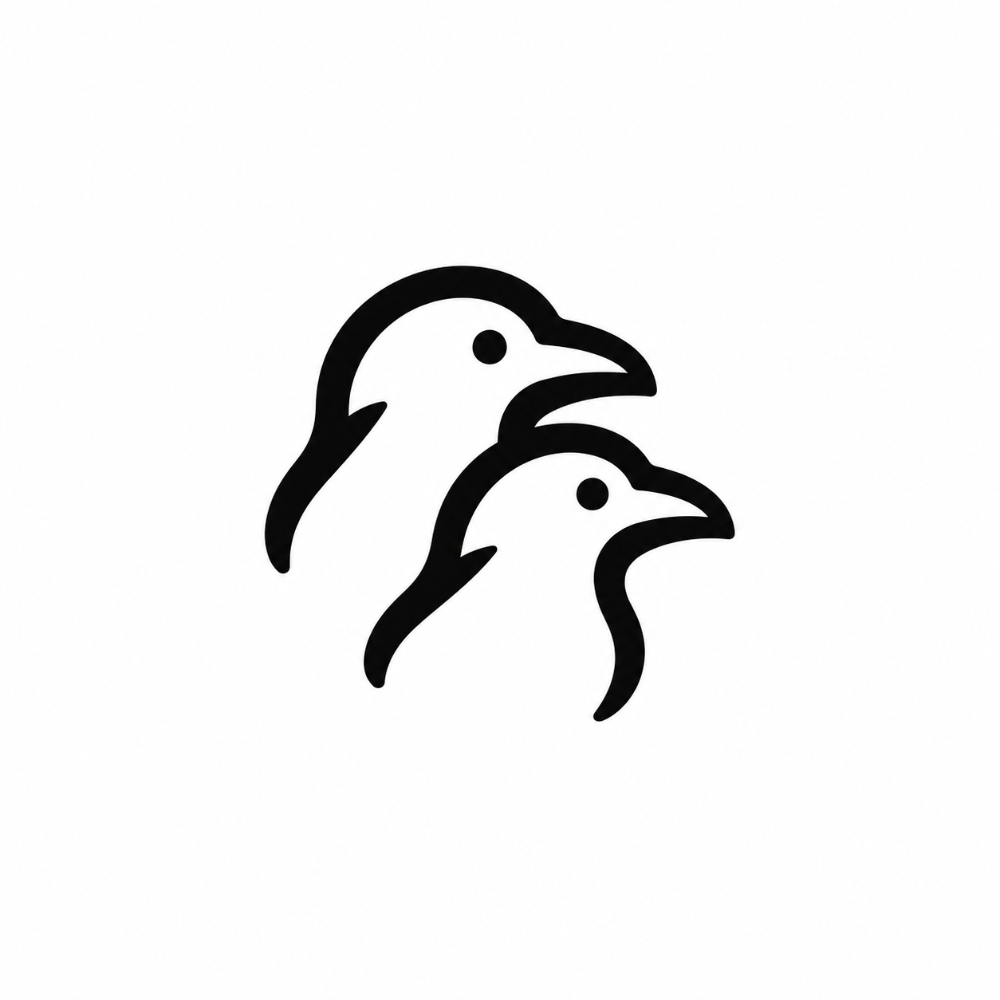

# Ravomi 品牌与角色规范

版本日期：2026-10-11。**Arcraven 是公司名，Ravomi 是产品名。** Ravomi 让人在无限画布上召唤、连接并管理多个 Agent，将任务、代码、素材与子代理组织为可协作的模块。品牌表达与产品核心一致：多 Agent 协作可见、可连接、可干预，人能够掌握全局并推进多个工作方向。

“人和 Agent，共绘工作”可用作辅助宣传语；正式产品说明优先写清无限画布和多 Agent 协作。界面中使用 `Ravomi`，公司归属场景使用 `Arcraven` 或 `Ravomi by Arcraven`，不把两者当成可互换的产品名称。

本文件管理品牌角色与资源使用。[DESIGN.md](../../DESIGN.md) 管理 UI/UX、颜色角色和交互，[AI_UI_RULES.md](../../AI_UI_RULES.md) 管理面向 AI 的实施规则。下文的目标规格不表示对应资产或运行时功能均已完成。

## 已确定的视觉方向

**迷幻、神秘而克制。** 品牌以极简团子猫为识别核心：石墨黑主体、局部雾蓝紫柔光和细颗粒。安静、灵动和好奇来自轮廓与双眼的位置关系；不靠增加五官、身体部件或装饰来表达。

### 角色形态

- 一个完整、圆润、可略微不对称的团子轮廓，头身一体；两只小耳朵融入外轮廓。
- 恰好两枚小椭圆眼睛，颜色为清晰的浅暖白；没有额外的鼻点、嘴巴或表情线。
- **无嘴、无鼻、无胡须、无尾巴、无脚、无手臂与其他四肢**。不增加腹部线、服装、翅膀或挂件。
- 简单轮廓在缩小后仍应成立；禁止将极简标记重新画成复杂毛绒插画、玻璃玩具或高光强烈的 3D 角色。

小猫可作为 Agent 头像或品牌标记。不同 Agent 的身份由名称、职责、类型与稳定标识表达；运行状态由 UI 的文字和状态组件表达，不依靠改变猫的身体、眼睛数量或随机换色。

### 色彩与材质

| 角色 | 目标色值 | 使用方式 |
| --- | --- | --- |
| 石墨黑 | `#202126` | 猫的主要体块，保持安静、深色的整体识别 |
| 雾蓝 | `#839ABE` | 局部边缘光，向石墨主体柔和过渡 |
| 灰紫 | `#9690B2` | 少量过渡或邻接边缘，保持低饱和 |
| 浅暖白 | `#F5F4EE` | 眼睛与品牌展示底色的建议值 |
| 字标 | 近石墨黑 | 平整、清楚，无颗粒、模糊或渐变 |

以上为后续绘制建议，不声称当前位图的每个像素与 token 完全相等。品牌材质以深色为主，蓝紫仅作用于一侧或小范围轮廓。细颗粒在柔光区域内渐隐，不散落成粒子，不形成大片外发光。边缘可以轻柔，但双耳和整体剪影必须辨认清楚。

当前 Logo 的受光集中在左上耳缘与左侧，向左下紫色和石墨暗部过渡；双眼为清楚的浅暖白椭圆。用户提供的「暗夜幽灵 / Noisy Midnight Blob」风格卡补充了材质制作方向，其色值不是原图的精确采样。分层、参数试值、组件应用和尺寸降级统一见 [DESIGN 的目标视觉系统](../../DESIGN.md#目标视觉系统)；不修改本表的既有目标色，不给当前 PNG 重复加噪点或模糊。

避免彩虹色、荧光霓虹、亮粉橙渐变、大面积光晕、真实毛发和复杂内部结构。界面中的文字、图标、卡片与连线不继承猫的颗粒和柔焦；品牌效果不能降低工作界面的清晰度。深色界面中的猫需要可辨认的容器或专用对比版本，不能简单叠上强光补救。

### 字标、留白与小尺寸

字标拼写固定为 `Ravomi`，与角色保持清晰的水平关系。现有主图是位图，未提供字体授权或可编辑字形源文件；不推断字体名称，不把相似系统字体重排宣称为原字标。普通 UI 中可用产品名称文本，仍需遵循界面字体系统。

独立标记和锁定组合制作后，建议外部安全留白至少为猫可见高度的四分之一，图形与字标之间保留约同等的舒适间隔；最终比例须对照当前主图验收。当前 PNG 使用其已有留白，不为塞入小控件随意裁剪或变形。

| 场景 | 目标方式与状态 |
| --- | --- |
| README、介绍、品牌展示 | 使用现有横版 PNG，等比缩放；建议展示宽度至少 320 px |
| 导航标题、关于页小标题 | 当前可用清晰的 Ravomi 文本；不将整张横版图压成方形 |
| 32–64 px Agent 头像 | 方形猫头像已提供；嵌入 UI 前仍需检查实际尺寸，材质强度随尺寸降低 |
| 16–24 px 小图标 | 后续制作简化实色轮廓与双眼，优先可辨认；不要求保留颗粒 |
| 深色背景 / 单色印刷 | 后续制作专用对比版与单色版；不直接反相整张 PNG |

独立标记需在 16 / 24 / 32 / 64 px 实际大小检查，至少比较深浅背景、1× / 2× 和常用系统缩放。细节减少不能增加五官。未完成上述资产和检查前，不能把当前横版位图描述为完整应用图标系统。

## 当前资源与用途

- [ravomi-avatar-cutout.png](ravomi-avatar-cutout.png)：为深色首页从已确认头像衍生的 1254 × 1254 RGBA 透明底版本。使用内置 imagegen 移除暖白背景，保持一体轮廓、双耳双眼及局部蓝紫颗粒光；原始头像未覆盖。用于首页侧栏与主图。生成约束和来源见 [素材记录](ravomi-avatar-cutout.md)。

- 文件：[ravomi-logo.png](ravomi-logo.png)，原样保存用户本轮提供的 PNG 图片，1774 × 887 像素，不是透明底或可编辑矢量稿。
- 造型：一体圆润团子猫、双耳、两枚浅色椭圆眼睛、局部蓝紫色边缘光，右侧搭配 Ravomi 字标，使用浅暖色背景。
- 使用：等比缩放并保留完整构图、背景和留白，不拉伸、不重绘、不以滤镜改变现有资源。README 展示该主图；界面标题、首页与关于页当前使用 Ravomi 文字标识。
- [ravomi-avatar.png](ravomi-avatar.png)：1254 × 1254 像素的独立团子猫头像，暖象牙白不透明背景，为 GitHub 等圆形裁切场景保留留白。通过内置图像生成工具从已确认主图衍生，保留两耳两眼及局部蓝紫柔光；不是可编辑矢量稿。
- 已检查头像的完整轮廓、五官数量与圆形裁切留白；未完成全部系统缩放及 16 / 24 / 32 / 64 px 应用图标验收。新增 [应用图标导出](app-icons/README.md) 从此头像生成，网页、原生窗口及 Linux/macOS 打包配置已经引用；32 px 轮廓和双眼已目视检查。透明背景、单色、深色及 16 px 专用简化版本尚未制作，跨平台安装仍需分别验收。
- 来源：仓库主图由用户直接提供；不因文件外观推断其字体或制作流程。旧 H&M 与 Graplu 资源作为历史来源保留。
- [ravomi-workspace-concept.png](ravomi-workspace-concept.png)：静态 UI 概念图，用于说明素净外壳、清晰画布及品牌猫的组合方式；它不是当前可运行版本的截图，也不是 Agent 功能完成的证据。
- [ravomi-style-card.png](ravomi-style-card.png)：用户确认采用的视觉风格卡；[生成记录](ravomi-style-card.md)保留提示词。工作区以暖白／石墨、局部品牌材质、清晰内容和胶囊主操作落实，详细参数与实现边界以 DESIGN 为准。

概念图中的图标、状态、流程和文字用于表达目标体验；实现时以产品阶段、领域模型和本仓库规范校验，不逐像素照抄图中可能存在的生成瑕疵。

## 交付与变更检查

品牌变更需确认名称、轮廓、双眼、配色角色、缩小识别和使用背景，并说明修改的是原始资产还是新增的衍生版本。保留原始文件与来源，新增透明、单色、深色或矢量版本要分别命名并验收；位图嵌入 SVG 不算可编辑矢量 Logo。

验收分别记录资产存在、格式正确、小尺寸可辨和视觉获准的状态。文档中的目标规格、生成概念图以及历史检查结果不能代替当前资产的实际验证。UI 实施按 [DESIGN.md](../../DESIGN.md) 的主题、缩放和无障碍检查执行。

## 历史 H&M Logo

- 文件：[hm-ravens.png](hm-ravens.png)，保留生成原图及白色背景，属于位图资源，不是可编辑矢量源稿。
- 状态：H&M 阶段选择的圆润双鸦版本，已由 Ravomi 品牌主图替代。
- 造型：两只朝右、上下错位的渡鸦头部，使用黑色粗轮廓、小圆眼与较短鸟喙表达 Huginn 与 Muninn；不含中央眼睛及羽毛纹样。
- 使用：仅作历史存档，保留构图和留白。
- 来源：通过内置 imagegen 生成。设计从用户微信参考图的双鸦意象出发，按反馈调整为具象、简洁、黑白且较可爱的双鸦轮廓；Manus 仅作为简洁图形风格参考。
- 本版生成提示：在上一版黑白双鸦 Logo 基础上保留错位朝右的构图，圆润头型、缩短鸟喙、保留小圆眼，软化颈部末端；通过比例增加亲和感，不增加羽毛、腮红、装饰、文字或渐变。

## 历史 Graplu 品牌资源

状态：历史品牌与兼容资源，已不再定义 Ravomi 的新视觉方向。2026-10-09 按用户要求从 `project-graph/docs/branding/graplu/` 原样迁入本项目。以下保留该阶段的几何、配色和来源记录，便于维护旧打包资源，不应将其四节点造型、Catppuccin Mocha 配色或渐变边框复制为新的 Ravomi Logo。

### 历史文件

- `graplu-icon.svg`：带 Mocha Base 底板及三色渐变边框的应用图标。
- `graplu-mark.svg`：透明底标记。
- `preview.html`：大图与 128 / 64 / 32 / 16 px 预览。
- `reference-four-nodes.png`：用户本轮提供的布局参考图，原样保存，仅用于对照。

历史方案保留在来源项目中；本目录收录历史 SVG、规范、预览页和布局参考图。系统打包中的旧图标暂作兼容资源，后续随新图标定稿替换。

### 历史几何

画布为 512 × 512。四个节点中心为 (152, 176)、(360, 176)、(152, 336)、(360, 336)，关于画布中心对称。四个节点共用一个 114 × 114 的 `canvas-shape` 路径，由上一版 120 × 120 轮廓等比缩小 5%；八段三次贝塞尔曲线的形状比例保持，四边与转角均有弧度，各段切向连续，轮廓上下左右对称。

外框、节点轮廓和连线的可见宽度均为 **16**，缩至 64 px 时均为 2 px。节点描边后的外尺寸为 130 × 130，内部窗口最大跨度为 98 × 98；上下节点最小间距为 30。内外轮廓由同一路径的居中描边形成等距偏移；内部填色也复用该路径，避免另外拼接不同圆角的内孔。

两条 S 形曲线连接对角节点，端部随节点调整至 x = 209、303，保持水平接入。淡紫色连接在交叉处位于上层；保持完整的圆润曲线，不裁出尖锐缺口。节点最后绘制并覆盖曲线端头。主体外缘 x = 87…425、y = 111…401。

底板保持标准圆弧圆角矩形。描边中心矩形为 (8, 8, 496, 496)，半径 120，完整的 16 单位描边均在画布内；外轮廓半径为 128、内轮廓半径为 112。所有图形均为可编辑的 SVG 几何元素及原生渐变，无字体、位图、脚本、滤镜或外部资源。

项目节点的实现是 `roundRect`，默认 `NODE_ROUNDED_RADIUS = 8`，半径会随字体与画布缩放变化。图标以用户最新指定的四节点布局参考为视觉依据，不声称图标与应用节点的参数相同。应用渲染代码未修改。

### 历史配色

色值取自 [Catppuccin 官方调色板](https://raw.githubusercontent.com/catppuccin/palette/main/palette.json)的 Mocha 主题（本次核对版本 1.8.0）。

| 色名 | 色值 | 用途 |
| --- | --- | --- |
| Base | `#1E1E2E` | 底板主体、节点内部底色 |
| Mantle | `#181825` | 底板暗部 |
| Surface 0 | `#313244` | 底板左上亮部 |
| Blue | `#89B4FA` | 右上与左下画板、对应连线、外框中段 |
| Lavender | `#B4BEFE` | 左上与右下画板、对应连线、外框起色 |
| Sapphire | `#74C7EC` | 外框末色 |

节点内部使用对应强调色以 16% 不透明度叠在 Base 底色上，节点轮廓与连线保持纯色。第一条连接（左上至右下）使用纯 Lavender `#B4BEFE`；第二条连接（左下至右上）使用纯 Blue `#89B4FA`。外框从左上至右下依次为 Lavender、Blue、Sapphire。底板采用 Surface 0 → Base → Mantle 径向渐变，形成轻微明暗层次。透明标记使用相同节点和连线，不包含底板及外框。

### 历史制作依据与检查

以下是 Graplu 资源制作时留下的过程记录，并非本次 Ravomi 规范更新新执行的验证：当时阅读本地 `vi-design-delivery` 的参考继承、几何一致性及原生矢量交付方法，并参考公开的 [icon-draw](https://github.com/Paldom/icon-designer-skills/blob/main/skills/icon-draw/SKILL.md)、[icon-critique](https://github.com/Paldom/icon-designer-skills/blob/main/skills/icon-critique/SKILL.md)及其评审维度。当时采用实色轮廓、视觉重量、小尺寸渲染及前后对照的方法；未安装或运行该远程 skill 的配套校验脚本，未声称通过其完整检查流程。

- 本轮继承：四节点中心布局、连续曲线圆角、蓝紫配色、统一线宽及三色外框。
- 本轮修改：紫色节点之间的连线改为纯 Lavender，与节点轮廓同色；两个 SVG 同步移除连线渐变定义。
- 文件检查：使用 XML 解析检查两个当前 SVG 文件；没有嵌入图片、外部引用、脚本或字体依赖。
- 视觉检查：以浏览器实际渲染查看大图与 128 / 64 / 32 / 16 px。16 px 的窗口很小，主要依靠整体轮廓识别。
- 布局参考和当前设计并排展示。上述检查验证可读性与文件完整性，不等同于用户认可外观。

### 历史资源使用

- 整体等比缩放，保留节点大小、线宽比例与曲线控制点。
- 推荐至少 32 × 32 px；需要辨认完整的节点与交叉连线细节时建议使用 64 px 或更大尺寸。
- 透明标记推荐用于深色背景。
- 透明标记没有外部底板，但保留画板内部的 Base 填充，以遮住连线端头。
- 独立标记用于版面时，外部至少留出相当于节点短边四分之一的空白。
