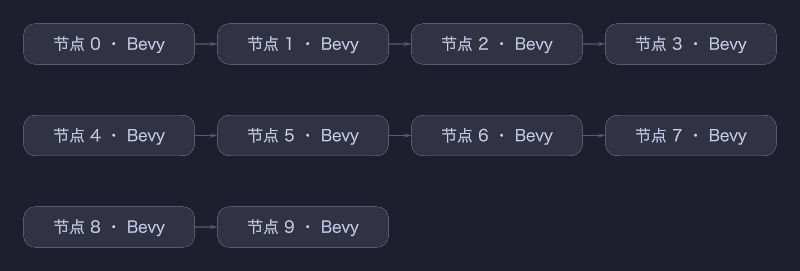

# Ravomi · Apple Silicon DMG

此流程打包现有 Bevy 原生画布，不代表 React/Tauri 入口、完整多 Agent 能力或所有目标平台已经发布。产品状态见 [README](../../README.md) 和 [PRD](../../PRD.md)，应用层迁移见 [app/README](../../app/README.md)。

发布资源按 [BRAND](../../assets/branding/BRAND.md) 核对；界面验收按 [DESIGN](../../DESIGN.md) 与 [AI_UI_RULES](../../AI_UI_RULES.md) 执行。新团子猫强调简单轮廓和局部柔光，安装图标需单独检查小尺寸识别；窗口文字、控件和连线保持清晰。以下已有构建和截图记录不是新视觉规范的验收结果。

在 Apple Silicon Mac 上运行，需要 Xcode 命令行工具和 Rust >=1.95：

```bash
bash packaging/macos/package.sh
```

构建目标固定为 `aarch64-apple-darwin`，不启用特定 CPU 的指令集；适用于包括 M5 在内的 Apple Silicon。最低部署版本设为 macOS 13。输出位于 `target/macos-package/`，包含 DMG 和 SHA-256 文件。

应用包包含原生可执行文件、图标、许可证与贡献者说明，DMG 提供拖入 Applications 的快捷方式。打包脚本现在从 `assets/branding/app-icons/1024x1024.png` 生成团子猫 ICNS，包内可执行文件和图标均命名为 Ravomi；Bundle ID 保留兼容值。旧 `packaging/macos/icon-1024.png` 仅保留历史来源，不再被打包脚本引用。本轮在 Linux 修改并静态检查脚本，尚未重新构建或验收 macOS DMG。

默认采用 ad-hoc 签名，脚本校验应用签名、Info.plist 和 DMG。未配置 Developer ID 签名或 Apple 公证。运行时使用 macOS 自带的 `Hiragino Sans GB.ttc`，也可通过 `--font` 指定其他字体。

窗口使用透明标题栏与全尺寸内容视图，隐藏系统标题文字，保留原生红黄绿按钮。顶部 36 逻辑像素沿用应用背景，留出按钮与拖动区域；该安全区不随应用 UI 缩放放大或缩小。原生右上角不再重复显示最小化、最大化和关闭按钮，系统关闭仍进入未保存确认流程。Tauri 入口也采用 Overlay 标题栏；拖动区域与编辑控件分离。此次在 Linux 完成实现与回归，macOS 的拖动、双击缩放、全屏返回、红黄绿按钮和未保存确认仍需实机验收。已安装的旧应用不会自动更新，需重新运行本目录打包脚本并替换 Applications 中的应用。

2026-10-11 标题栏修复验证：`cargo fmt --all --check`、`cargo test --release --workspace --locked`（253 通过，26 忽略）、`cargo clippy --release --workspace --all-targets --locked -- -D warnings` 通过；`app` 内 `npm run build`、`npm test`（19 通过）和 `npm exec tauri build -- --no-bundle` 通过。新增前端回归以模拟 Mac 平台和 IPC 验证 360 / 1200 宽度、100% / 150% / 200% 缩放下的安全区与控件分离，不等同于 AppKit 实机验收。Tauri 配置依据[官方窗口定制说明](https://v2.tauri.app/learn/window-customization/)。

2026-10-10 在 macOS 26.6.2 / Apple M4 / Metal 上验证原生启动和中文节点图离屏渲染；镜像内 `.app` 是 arm64 Mach-O，只链接系统动态库。测试机处于锁屏状态，窗口截图为空白，未据此声称交互界面验收通过。尚未在 M5 实机验证。


