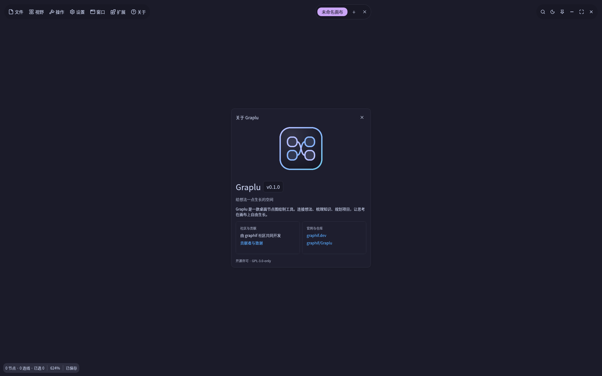

# 关于窗口 · 2026-10-10

> 历史证据：以下保留 2026-10-10 的 Graplu 关于页、测试数与截图，不是 Ravomi 新品牌或 UI 的验收。当前按 [DESIGN](../DESIGN.md)、[AI_UI_RULES](../AI_UI_RULES.md) 与 [BRAND](../assets/branding/BRAND.md) 检查清晰布局、团子猫标识及真实产品阶段说明；重新实现后另附截图和结果，保留第三方来源与致谢。

参考 `project-graph/master`（`1fb1b5cc`）的 `app/src/sub/SettingsWindow/about.tsx`：大 Logo、名称和版本徽标、简介、两列信息卡片。保留 Graplu 品牌及社区致谢来源，复用 `theme::tool_frame/tool_style/tool_header`，空间不足时卡片单列、正文滚动、关闭按钮固定。

Linux / Intel Iris Xe / Mesa 26.2.3 / Vulkan 实际预览覆盖深浅主题和 100%、150%、200% UI 缩放。下图为深色 100% 的应用截图；较高缩放下正文可滚动。

验证：`cargo fmt --all --check`、`cargo test --workspace --locked --release`（224 项通过）、`cargo clippy --workspace --all-targets --locked --release -- -D warnings`。预览入口为 `--preview --preview-tool about`，可组合 `--light`、`--ui-scale`、`--screenshot`。
